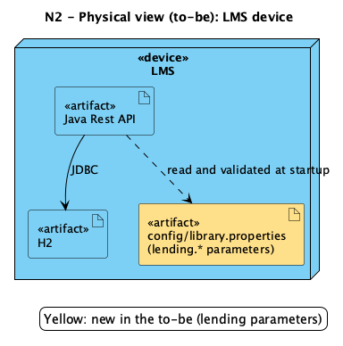
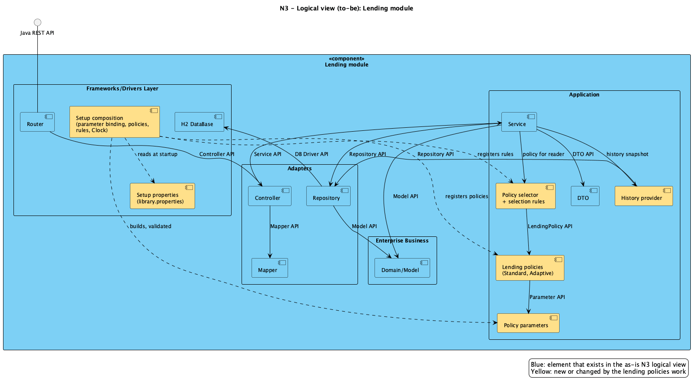
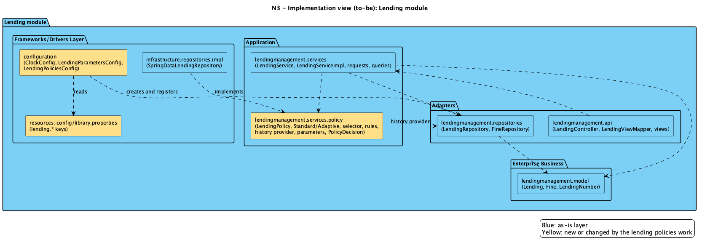
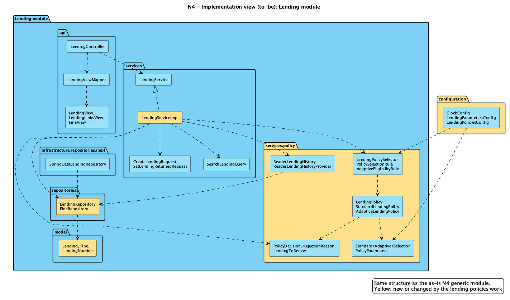

# ADD

This file details the ADD process used to develop new functionalities.

## Design iterations

- [Extensibility — roadmap and iteration 1: bibliographic sources](Extensibility.md): three planned iterations, for bibliographic information, notifications and lending policies. Iteration 1 groups source extension, composition, configuration and test isolation; only its proposed design is detailed so far. Not yet implemented.

- [Testability — roadmap and iterations](Testability.md): proposed SUT boundaries, isolation tactics, test categories, AAA scenarios and evaluation for bibliographic sources (iteration 1), notifications (iteration 2) and lending policies (iteration 3). Notification testing is designed; no notification test implementation is claimed.

- [Configurability — roadmap and iterations](Configurability.md): setup-time selection of sources and channels, lending parameters bound and validated at startup, and per-reader policy selection. Not yet implemented.

## Requirements
Below are listed the non-functional and functional requirements

### Non-functional requirements
#### Bibliographic information
- The system must gather book data from external systems, such as Google Books and Open Library.
- The system must account for different external systems may provide different data models and
  provide different subsets of bibliographic information.
- The systems must support what external book information systems are consulted at setup.
- The system must allow consultation of more than one external book information system at a time.
- The system must support new bibliographic information sources with limited impact on existing
  functionality.

#### Reader notifications
- Reader notifications must be done via email, SMS and webhook.
- Reader notifications may use more than one method at a time. 
- At setup time, the system must allow what notification systems are to be used.
- New notification systems should have the possibility to be added without impacting existing functionality.

#### Lending policies
- The system must support different lending policies according to the complementary lending policy
  specification.
- The applicable lending policy must be selected automatically for each reader on every new lending or renewal request, according to the faculty selection rules.
- All quantitative lending policy parameters must be externally configurable at setup time, without changing the source code, and configured values must satisfy the policy constraints (specification section 5).
- The system must support addition of new lending policies with limited impact on existing functionality.

### Functional requirements
#### Bibliographic information
- US1: As a Librarian, I want to create a book using its ISBN, so that the system retrieves and fills in the available bibliographic information from the configured external sources, reducing manual entry.
- US2: As a Librarian, I want to search for a book's bibliographic information by ISBN or title in the external sources, before registering it in the library catalogue.
- US3: As a Librarian, I want the system to combine the data returned by several external sources into a single book record when more than one source is configured, filling missing fields from whichever source provides them.
- US4: As a Librarian, I want to be able to add more new bibliographic information sources.
- US5: As an Administrator, I want to define at setup time which bibliographic information sources are enabled, without changing the source code.

#### US1 acceptance criteria
- AC1: The system fills in available bibliographic fields from the configured sources.
- AC2: Existing catalogue authors and genre may be associated automatically only when the correspondence is unambiguous. Matching rules must be defined and tested; a name match alone is not assumed sufficient.
- AC3: Missing required data or ambiguous associations are reported to the librarian for completion or confirmation. No incomplete book is saved.
- AC4: Authors and genres absent from the catalogue are created only through an explicit librarian decision, not automatically during retrieval.
- AC5: When metadata and catalogue associations are sufficient and unambiguous, registration requires no additional manual completion.

#### Reader notifications
- US6: As a Librarian, I want the Reader to be notified when a lending is about to reach its due date, through the notification channels enabled in the system.
- US7: As a Librarian, I want the Reader to be notified when a lending is overdue and a fine is being applied.
- US8: As a Reader, I want to choose through which of the enabled channels (email, SMS, webhook) I receive notifications, selecting at least one and being able to select more than one at a time.
- US9: As an Administrator, I want to define at setup time which notification systems are enabled, without changing the source code.

#### Lending policies
- US10: As an Administrator, I want to set the lending policy parameters (Standard, Adaptive and selection) at setup time through external configuration, without changing the source code, and have invalid values rejected at startup.
- US11: As a Reader, I want my applicable lending policy to be selected automatically from my history and current lending status on every new lending or renewal request.
- US12 (group proposal): As a Librarian, I want to consult the policy applicable to a reader and its parameters. A consultation endpoint is additional scope, not a requirement for a global active policy.
- US13: As a Reader, I want new lendings to follow the applicable Standard or Adaptive policy and receive a reason when rejected.
- US14: As a Reader, I want to renew a lending only when the re-evaluated policy permits it.

### Bibliographic behaviour — Confirmed decisions

- **Data:** retrieve ISBN, title, available description, author names and suggested genres, with source provenance. External names are metadata, not catalogue entities. Automatic cover import is outside this iteration.
- **Merge:** configured source order defines priority. Use the first available title/description; later successful sources fill missing fields. Keep the first non-empty author list and report differing lists rather than automatically unioning them. Combine genre suggestions without duplicates; the registered book still has one catalogue genre.
- **Catalogue associations:** associate a genre automatically only when exactly one catalogue entry matches after trimming outer whitespace and ignoring case. Multiple matching suggestions remain ambiguous and require librarian selection. A matching author name alone is a suggestion; automatic author association requires a reliable previously confirmed correspondence. Otherwise ask the librarian to select or explicitly create the author. Retrieval never creates authors or genres automatically.
- **Workflow:** separate lookup without persistence from ISBN-based registration. Register directly only when mandatory data and catalogue associations are resolved; otherwise return the retrieved information and completion needs without saving an incomplete book. The librarian can correct the proposed data.
- **Configuration:** read an external ordered source list at startup; invalid configuration prevents startup and changes take effect after restart. Provider communication remains behind `BibliographicTransport` with a defined timeout.

These behavioural decisions are confirmed. Implementation details remain to be specified: Java/REST contracts, storage of previously confirmed author correspondences, external configuration loading and HTTP client settings. Search by title remains proposed scope.

### Lending rules from the faculty specification
Scope for this three-person group: all sections of the *ARQSOFT 2026-2027 Lending Policies Specification v1.0* apply, including section 4 (automatic policy selection, brief 1.3.3.3 item 3) and section 5 (external setup-time parameter configuration, US10/QAS7).
- LP-S1 (2.1): Standard permits at most `MaxActiveLendings > 0` active lendings.
- LP-S2 (2.2): Standard lending duration is `LendingPeriod > 0` days.
- LP-S3 (2.3): Standard permits at most `MaxRenewals >= 0` renewals, each for `RenewalPeriod > 0` days.
- LP-S4 (2.4): A reader with any overdue lending cannot start a new Standard lending.
- LP-S5 (2.5): An overdue lending cannot be renewed under Standard.
- LP-A1 (3.1): Adaptive permits at most `MaxActiveLendings > 0` active lendings.
- LP-A2 (3.2-3.4): Below `FirstThreshold`, use `LongPeriod`; from `FirstThreshold` inclusive to `SecondThreshold` exclusive, use `StandardPeriod`; at or above `SecondThreshold`, use `ShortPeriod`.
- LP-A3 (3.5): Validate `0 < FirstThreshold < SecondThreshold < MaxActiveLendings` and `LongPeriod > StandardPeriod > ShortPeriod > 0`.
- LP-A4 (3.6): Adaptive renewal requires the resulting lending to continue satisfying the applicable policy conditions.
- LP-A5 (3.7): A reader with any overdue lending cannot start a new Adaptive lending.
- LP-SEL1 (4.1-4.2): Standard is the default. Adaptive applies only when, in the previous `HistoryPeriod > 0` months, the reader completed at least `MinCompletedLendings > 0`, returned at least `MinOnTimeRatio` (0-100%) of those lendings on time, and has no currently overdue lending. All conditions must hold.
- LP-SEL2 (4.3): Re-evaluate selection for each reader on every new lending and renewal request.
- LP-CFG1 (5.1-5.2): All quantitative parameters above are externally configurable at setup time; changing a value requires no source change.
- LP-CFG2 (5.3): Configured values must satisfy the constraints of the corresponding policy; invalid values are rejected.

### Scope and classification notes
The existing non-functional section mixes required functional capabilities with quality requirements. Retrieving external data and sending notifications are functional; limited impact of additions is extensibility; setup-time selection is configurability. User stories refine these capabilities.

Search by title (US2), merge behaviour (US3), specific notification events (US6/US7), reader preferences (US8), and policy consultation (US12) are group proposals requiring scope confirmation. Coverage percentages, effort estimates and timings in the QAS are group targets, not faculty requirements.

## Quality Attribute Scenarios
The Library Management service does not adequately support **Extensibility**, **Configurability** and **Testability**. The following scenarios make these qualities concrete and measurable.

### Extensibility

#### QAS1 – Adding a new bibliographic information source
**Related requirements:** US4, NFR "support new bibliographic information sources with limited impact"

| Element | Statement |
|---|---|
| Stimulus | A new external bibliographic information source (e.g., ISBNdb) must be supported, with its own data model and its own subset of bibliographic fields. |
| Stimulus source | Developer, following a request from the Librarian / library management. |
| Environment | Design and development time, with the system already integrating Google Books and Open Library. |
| Artifact | Book management module: bibliographic source abstraction, source adapters and the data mapping to the internal `Book` model. |
| Response | The developer adds a new adapter that implements the existing source interface and maps the external data model to the internal one. Existing sources, `BookService` and `BookController` remain unchanged. |
| Response measure | Only new classes are created (one adapter and one mapper/DTO, at most). No existing class is modified. 100% of the existing tests still pass. Effort is at most 1 person-day. |

#### QAS2 – Adding a new notification channel
**Related requirements:** US6, US7, US8, NFR "new notification systems added without impacting existing functionality"

| Element | Statement |
|---|---|
| Stimulus | A new notification channel (e.g., push notifications) must be added alongside email, SMS and webhook. |
| Stimulus source | Developer, following a request from library management. |
| Environment | Design and development time, with email, SMS and webhook channels already in production. |
| Artifact | Reader notification module: notification channel interface and channel implementations. |
| Response | The developer implements the channel interface in a new class. The notification dispatcher discovers it and sends through it together with the other enabled channels. Readers can then select it as one of their channels. |
| Response measure | One new implementation of the channel interface plus its registration at setup. No changes to existing channels, the dispatcher, or the lending module. 100% of the existing tests still pass. Effort is at most 2 person-days. |

#### QAS3 – Adding a new lending policy
**Related requirements:** US13, NFR "addition of new lending policies with limited impact"

| Element | Statement |
|---|---|
| Stimulus | A new lending policy defined in the complementary lending policy specification must be supported. |
| Stimulus source | Developer, following a decision from library management. |
| Environment | Design and development time, with Standard and Adaptive already implemented and selected separately for each reader. |
| Artifact | Lending management module: lending policy interface, policy implementations, `LendingServiceImpl`. |
| Response | The developer creates a new policy implementation. `LendingServiceImpl` validates new lendings through the policy interface, so it does not need to change. |
| Response measure | Add the new policy, parameter definitions and tests; extend selection registration/rules where needed. Existing policies, `LendingServiceImpl` and `LendingController` remain unchanged. 100% of existing tests still pass. The 1 person-day target is a group estimate. |

### Configurability

#### QAS4 – Choosing bibliographic sources at setup
**Related requirements:** US5, NFR "support what external book information systems are consulted at setup", "consultation of more than one system at a time"

| Element | Statement |
|---|---|
| Stimulus | The Administrator wants to enable Open Library and disable Google Books, or enable both at the same time. |
| Stimulus source | Administrator. |
| Environment | Setup / deployment time. |
| Artifact | External configuration (`application.properties`, environment variables or profile) and the source selection mechanism. |
| Response | At startup, the system reads the configuration and only queries the enabled sources. When more than one is enabled, it queries all of them and merges the results (US3). |
| Response measure | 0 lines of source code changed and no recompilation. Takes effect after one application restart. The change takes at most 5 minutes. |

#### QAS5 – Choosing notification channels at setup
**Related requirements:** US9, NFR "at setup time, the system must allow what notification systems are to be used"

| Element | Statement |
|---|---|
| Stimulus | The Administrator wants to enable only email and webhook notifications. |
| Stimulus source | Administrator. |
| Environment | Setup / deployment time. |
| Artifact | External configuration and the notification channel registry. |
| Response | Only the enabled channels are loaded. Readers can only select among enabled channels, and notifications go out only through them. |
| Response measure | 0 lines of source code changed and no recompilation. Takes effect after one application restart. Disabled channels send 0 notifications. |

#### QAS6 – Reader selecting notification channels at runtime
**Related requirements:** US8, NFR "reader notifications may use more than one method at a time"

| Element | Statement |
|---|---|
| Stimulus | A Reader changes their notification preferences, e.g., from email only to SMS and webhook. |
| Stimulus source | Reader, through the REST API. |
| Environment | Runtime, under normal operation, with email, SMS and webhook enabled at setup. |
| Artifact | Reader management module (reader notification preferences) and the notification dispatcher. |
| Response | The system validates that every chosen channel is enabled and stores the preferences. Later notifications for that Reader go only through the chosen channels. A choice that includes a disabled channel is rejected with an error message naming that channel, and a choice with no channel is rejected. |
| Response measure | 0 code changes and 0 restarts. The new preferences apply to the next notification sent to that Reader. 100% of choices that include a disabled channel or no channel are rejected. Other Readers' preferences are unaffected. |

#### QAS7 – Configuring lending policy parameters at setup
**Related requirements:** US10, LP-CFG1, LP-CFG2

| Element | Statement |
|---|---|
| Stimulus | The Administrator wants to change the Standard `LendingPeriod` from 15 to 21 days and the Adaptive thresholds. |
| Stimulus source | Administrator. |
| Environment | Setup / deployment time. |
| Artifact | External configuration (`config/library.properties`, environment variables or profile) and the lending parameter binding. |
| Response | At startup, the system loads the values into the policy and selection parameters. New lendings, renewals and policy selection use them. Values that violate the policy constraints (e.g. `FirstThreshold >= SecondThreshold`, non-positive periods) stop startup with a message naming the parameter and the constraint. |
| Response measure | 0 lines of source code changed and no recompilation. Takes effect after one application restart. 100% of constraint violations are detected at startup. Existing lendings are not modified. |

#### QAS8 – Automatic per-reader policy selection at runtime
**Related requirements:** US11, US14, LP-SEL1, LP-SEL2

This scenario specifies runtime selection behaviour, rather than setup-time reconfiguration.

| Element | Statement |
|---|---|
| Stimulus | A reader requests a new lending or renewal. |
| Stimulus source | Reader, through the lending REST API. |
| Environment | Runtime, under normal operation, with active lendings and concurrent requests. |
| Artifact | Lending service, policy selector and reader-history access. |
| Response | Evaluate all Adaptive eligibility conditions for this reader. Select Adaptive only when all hold; otherwise select Standard. Validate the requested operation with that policy. |
| Response measure | Every new lending and renewal re-evaluates selection, without restart or manual switching. Tests exercise each condition and readers with different eligibility. Selection alone does not modify existing lendings. |

### Testability

#### QAS9 – Testing bibliographic sources in isolation
**Related requirements:** US1, US2, US3

| Element | Statement |
|---|---|
| Stimulus | A developer needs to test book creation by ISBN and the merging of data from several sources. |
| Stimulus source | Developer / CI pipeline. |
| Environment | Development and continuous integration, without network access to Google Books or Open Library. |
| Artifact | Book management module: source adapters, merge logic, `BookService`. |
| Response | Sources are injected through their interface, so they can be replaced by mocks or stubs. Adapters are tested against recorded responses, and the merge logic is tested with controlled data, including partial and missing fields. |
| Response measure | 100% of tests run without real external calls. At least 80% branch coverage on the adapters and merge logic. Each unit test runs in under 1 second. |

#### QAS10 – Testing notification channels without sending real messages
**Related requirements:** US6, US7, US8

| Element | Statement |
|---|---|
| Stimulus | A developer needs to verify that a Reader with several selected channels is notified through all of them when a lending is due or overdue. |
| Stimulus source | Developer / CI pipeline. |
| Environment | Development and continuous integration, without email/SMS providers or webhook receivers. |
| Artifact | Reader notification module: dispatcher and channel implementations. |
| Response | Channels are replaced by test doubles that record the calls. Tests assert which channels were used, for which reader, and with what content. |
| Response measure | 0 real messages sent during tests. At least 80% branch coverage on the dispatcher and channel selection logic. Each scenario is checked by at least one automated test. |

#### QAS11 – Testing lending policies independently
**Related requirements:** US10, US11, US13, US14

| Element | Statement |
|---|---|
| Stimulus | A developer needs to verify both policies, parameter constraints, renewals and automatic per-reader selection. |
| Stimulus source | Developer / CI pipeline. |
| Environment | Development and continuous integration. |
| Artifact | Lending policy implementations, policy selector and `LendingServiceImpl`. |
| Response | Each policy is tested as a standalone unit with injected parameters and a controllable clock, without starting Spring or the database. `LendingServiceImpl` is tested with a mocked policy. |
| Response measure | Every policy rule has at least one passing and one failing test case. At least 80% branch coverage on policy classes. Policy unit tests run in under 5 seconds in total. |

## Prioritization

This ranking is provisional. US14 and lending QAS need inclusion in the next prioritization review. Performance and Releasability require explicit scenarios before being used as architectural drivers. The scoring formula also remains to be defined.

The table below shows what we determined to be the priority of features to implement according to the ADD process:

|Requirements|Risk/Difficulty|Importance/Probability|Priority|
|-|-|-|-|
|Performance|High|Low|3|
|Releasability|High|High|4|
|US1|High|High|4|
|US2|Easy|High|2|
|US3|High|High|4|
|US4|Medium|High|3|
|US5|Easy|High|2|
|US6|Easy|High|2|
|US7|Easy|High|2|
|US8|Easy|High|2|
|US9|Medium|High|3|
|US10|Medium|High|3|
|US11|High|High|4|
|US12|Easy|High|2|
|US13|Easy|High|2|

## To-be views — Lending policies

The as-is views in `system-as-it-be/N1` to `N4` follow the same zoom levels as the C4 model. The lending policies work is shown at each level in the same notation (blue = already in the as-is view, yellow = new or changed).

| As-is level | C4 level | What it shows | Views in the as-is folder | Lending policies, to-be |
|---|---|---|---|---|
| N1 | System context | LMS as one component with its Java REST API and the Ninjas API | logical (VL), implementation (VI), physical (VF) | Unchanged: no new external system or API |
| N2 | Containers | LMS split into Backend and the H2 database | VL, VI, VF | Logical and implementation views unchanged. Physical view: one new artifact, `config/library.properties`, read at startup (below) |
| N3 | Components | One module in four layers: Frameworks/Drivers, Adapters, Application, Enterprise Business | logical (VL3), implementation (VI) | Both views below |
| N4 | Code | Packages and classes of a generic module | `VIL4_Generic` | Implementation view of the Lending module below; classes and their relations are in [Structure](Images/LendingPolicyStructure.png) and the [class diagram](Images/LendingClassDiagram.png) |

The mapping to C4 is by zoom level, not by deployment: the backend is a single deployable, so N2 has only one runtime container besides the database.

### N2 — Physical view (to-be)

### N3 — Logical view (to-be)

The Application layer gains the policy selector with its rules, the lending policies, the history provider and the policy parameters; `Service` delegates the lending rules to them (EXT-LP-01 to EXT-LP-05). The setup composition in the Frameworks/Drivers layer reads the lending properties, builds the validated parameters and registers the policies and rules (CFG-LP-03, CFG-LP-05).

### N3 — Implementation view (to-be)

### N4 — Implementation view (to-be)

New package `lendingmanagement.services.policy`, new `configuration` classes, and the changed classes `LendingServiceImpl`, `LendingRepository` (history window query) and `Lending` (renewal counter and reference date).

## Traceability — Lending policies

Each requirement is followed through the design decision (IDs in [Extensibility.md](Extensibility.md), [Configurability.md](Configurability.md) and [Testability.md](Testability.md)), the view that shows it, the production code and the tests. Package `lendingmanagement.services.policy` is written `policy`; test classes are under `src/test/java`. Status on 2026-10-23: all rows implemented and tested; `./mvnw test` 366 tests, 0 failures.

| Requirement | Design decision | View | Code | Tests |
|---|---|---|---|---|
| LP-S1 Standard max active lendings | EXT-LP-02, TST-LP-03 | [Structure](Images/LendingPolicyStructure.png) | `policy.StandardLendingPolicy`, `StandardPolicyParameters.maxActiveLendings` | `StandardLendingPolicyTest`; `LendingApiComponentTest` (fourth lending rejected); `LendingSystemTest` (limit, then a place frees after a return) |
| LP-S2 Standard period | EXT-LP-02, CFG-LP-03 | Structure | `StandardPolicyParameters.lendingPeriodDays`, `LendingServiceImpl.create` | `StandardLendingPolicyTest`; `LendingApiComponentTest` (limit date = today + 15) |
| LP-S3 Standard renewals | EXT-LP-01, EXT-LP-02 | Structure | `StandardLendingPolicy.evaluateRenewal`, `Lending.renew`, `LendingServiceImpl.renew` | `StandardLendingPolicyTest`, `LendingTest`, `LendingServiceImplPolicyTest`; `LendingApiComponentTest` (third renewal rejected) |
| LP-S4 / LP-A5 overdue blocks a new lending | EXT-LP-02, EXT-LP-04 | Structure | `StandardLendingPolicy`, `AdaptiveLendingPolicy`, `ReaderLendingHistoryProvider` | both policy tests; `ReaderLendingHistoryProviderTest`; `LendingApiComponentTest` (overdue reader rejected with the reason) |
| LP-S5 overdue lending cannot be renewed | EXT-LP-02 | Structure | `StandardLendingPolicy.evaluateRenewal`, `Lending.renew` | `StandardLendingPolicyTest`, `LendingTest`; `LendingApiComponentTest` (overdue renewal rejected) |
| LP-A1, LP-A2 Adaptive limit and periods | EXT-LP-02 | Structure | `policy.AdaptiveLendingPolicy`, `AdaptivePolicyParameters` | `AdaptiveLendingPolicyTest`; `LendingApiComponentTest` (period shrinks as the reader borrows more) |
| LP-A3 Adaptive parameter constraints | EXT-LP-02, CFG-LP-05 | [Parameter binding](Images/LendingParameterBinding.png) | `AdaptivePolicyParameters` (validated on construction) | `AdaptivePolicyParametersTest`; `LendingParametersConfigTest` (invalid value stops startup naming the parameter) |
| LP-A4 Adaptive renewal | EXT-LP-02 (design decision in the memo) | Structure | `AdaptiveLendingPolicy.evaluateRenewal` | `AdaptiveLendingPolicyTest` |
| LP-SEL1 selection of Adaptive | EXT-LP-03, EXT-LP-04, CFG-LP-02 | [Selection sequence](Images/LendingPolicySelectionSequence.png) | `policy.AdaptiveEligibilityRule`, `ReaderLendingHistoryProvider` | `AdaptiveEligibilityRuleTest`; `ReaderLendingHistoryProviderTest`; `LendingApiComponentTest` and `LendingSystemTest` (reliable reader gets 21 days; below the ratio or count stays Standard) |
| LP-SEL2 re-evaluation per request | EXT-LP-03, CFG-LP-01, CFG-LP-04 | Selection sequence | `policy.LendingPolicySelector`, `LendingServiceImpl` | `LendingPolicySelectorTest`; `LendingPoliciesConfigTest` (falls back to Standard once a lending is overdue); `LendingSystemTest` |
| LP-CFG1, LP-CFG2 / US10 / QAS7 external parameters | CFG-LP-03, CFG-LP-05 | Parameter binding | `configuration.LendingParametersConfig`, the three parameter records, `config/library.properties` (`lending.*`) | `LendingParametersConfigTest` (binding, override, invalid, missing, malformed), `StandardPolicyParametersTest`, `AdaptivePolicyParametersTest`, `PolicySelectionParametersTest` |
| US11 / QAS8 automatic selection | EXT-LP-03, CFG-LP-02 | Selection sequence, [Class diagram](Images/LendingClassDiagram.png) | `LendingPoliciesConfig` (ordered rules, Standard default) | `LendingPoliciesConfigTest`, `LendingSystemTest` |
| US13 reason when a lending is rejected | EXT-LP-01, EXT-LP-05 | Structure | `PolicyDecision`, `RejectionReason`, `LendingForbiddenException` (reason in the 403 body) | `PolicyDecisionAndHistoryTest`, `LendingServiceImplPolicyTest`, `LendingControllerTest` (403 with the reason), `LendingApiComponentTest` |
| US14 renewal only when the policy permits | EXT-LP-01, EXT-LP-05 | Class diagram | `LendingServiceImpl.renew`, `LendingController` (`POST /api/lendings/{year}/{seq}/renewal`, role READER), `Lending.renew` | `LendingServiceImplPolicyTest`, `LendingControllerTest`, `LendingApiComponentTest`, `LendingSystemTest` (renew, 403 for another reader or a librarian) |
| QAS3 add a policy with limited impact | EXT-LP-01, EXT-LP-03, EXT-LP-05 | Structure | `LendingPolicy`, `PolicySelectionRule`, `LendingPoliciesConfig` | Extension experiment in [Extensibility.md](Extensibility.md) (Analysis — Iteration 3): 3 existing files changed, service and selector untouched |
| QAS11 test policies independently | TST-LP-01 to TST-LP-09, CON-TST-10 | [Class isolation](Images/LendingPolicyClassIsolation.png), [Collaboration boundary](Images/LendingPolicyCollaborationBoundary.png) | injected `Clock` (`ClockConfig`), parameter records, history snapshot, constructor-injected `LendingServiceImpl` | All five levels listed in [Testability.md](Testability.md) (Analysis — Iteration 3); PIT 95% |

Not covered: US12 (consultation endpoint) is a group proposal and was not implemented.
