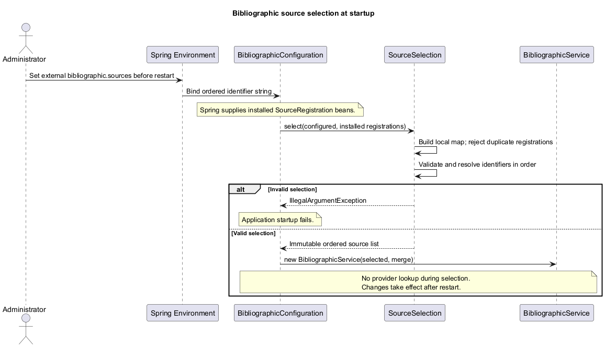
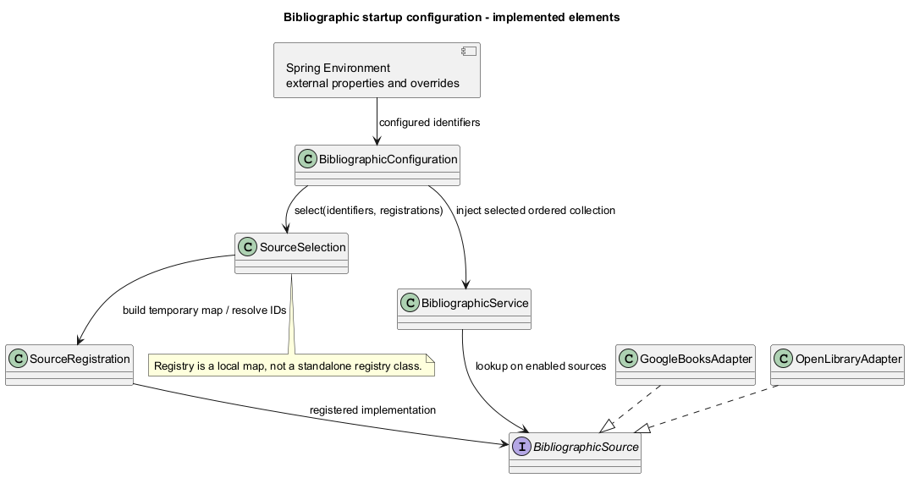
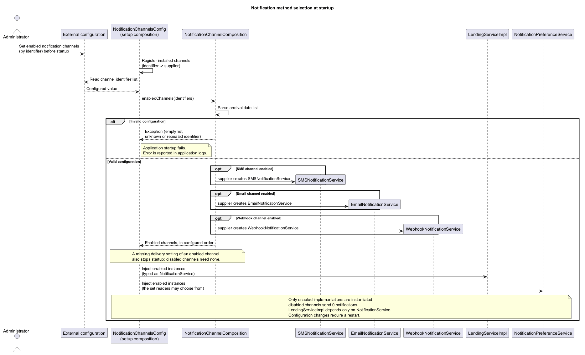
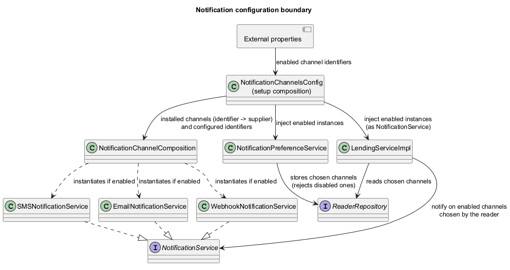
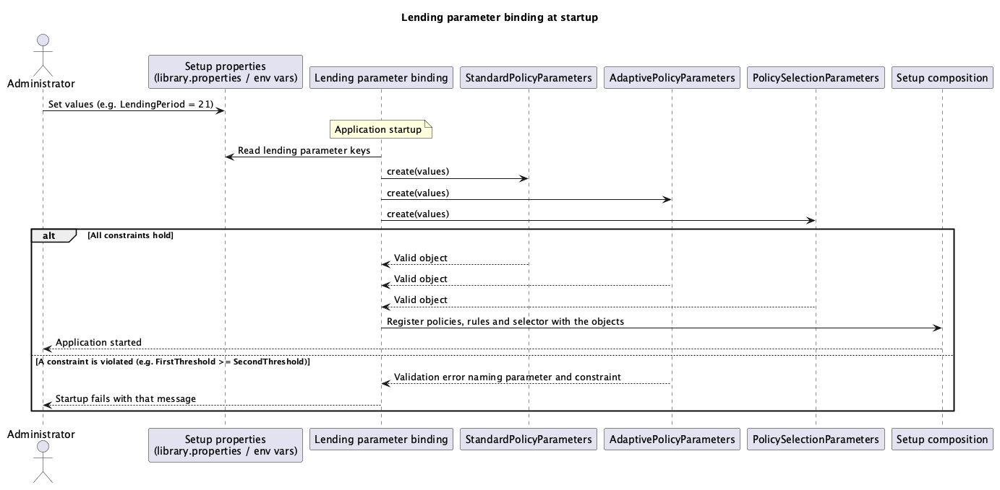

# ADD — Configurability

Bibliographic implementation update (2026-10-28): see [implementation, API and verification](BibliographicImplementation.md). The evidence applies to iteration 1 only.

Requirements and scenarios: [ADD.md](ADD.md). 
Extensibility design this document builds on: [Extensibility.md](Extensibility.md). 
Lending rules: *ARQSOFT 2026-2027 Lending Policies Specification v1.0*. 
Organization follows the faculty material *Something about Attribute-Driven Design 0.9*, Steps 1–8. 
Detailed rationale is recorded in the linked technical memos.

## Step 1 — Review inputs

### Requirement

The system must let the choice of bibliographic sources and notification channels be made at setup time, without changing source code (ARQSOFT 2026-2027 Project 1 for Students 1.1, sections 1.3.3.1–1.3.3.2). The lending policy specification (sections 1 and 4) requires that the policy applied to each reader be selected automatically, according to the reader's history, on every new lending and renewal. Section 5 of that specification requires all quantitative lending parameters to be externally configurable at setup time, without source changes, and to satisfy the policy constraints (US10, QAS7).

### Variation and configuration points

- Bibliographic sources: which of the installed sources (Google Books, Open Library, later others) are consulted, one or several at a time. Chosen at setup.
- Notification channels: which of the installed channels (email, SMS, webhook, later others) are enabled. Chosen at setup. Each reader then chooses among the enabled channels at runtime.
- Lending policies: which installed policy (Standard, Adaptive, later others) applies to a reader. Chosen automatically at runtime, per reader and per request, from the reader's history (specification section 4).
- Lending parameter values (`MaxActiveLendings`, `LendingPeriod`, `MaxRenewals`, `RenewalPeriod`, thresholds, periods, `HistoryPeriod`, `MinCompletedLendings`, `MinOnTimeRatio`): externally configurable at setup (specification section 5). Read at startup and validated against the policy constraints; a change takes effect after one restart.

## Step 2 — Establish goals and select inputs to be considered in the iteration

### Roadmap

| Iteration | Goal | Drivers / Related requirements | Design concepts to consider |
|---|---|---|---|
| Iteration 1 | Let the Administrator choose, at setup, which bibliographic sources are consulted, one or several. | QAS4 — Configurability; US5. Related: US3, EXT-BIB-04, QAS1, QAS9 | Configuration-driven behaviour, defer binding, setup-time composition, dependency injection |
| Iteration 2 | Let the Administrator choose, at setup, which notification channels are enabled, and let each reader choose among them at runtime. | QAS5, QAS6 — Configurability; US8, US9. Related: QAS2, QAS10 | Configuration-driven behaviour, channel registry, validation against the enabled set |
| Iteration 3 | Configure the lending parameters at setup, and select the applicable lending policy for each reader automatically on every new lending or renewal. | QAS7, QAS8 — Configurability; US10, US11, US14. Related: US13, QAS3, QAS11 | Configuration-driven behaviour (parameters, selection rules), fail-fast validation, dynamic binding, selector, controlled clock |

The roadmap is tentative: it orders architectural concerns, not coding stages. Design concepts are candidates to evaluate in each iteration. Each iteration closes the configuration point that the corresponding [Extensibility](Extensibility.md) iteration left open (EXT-BIB-04, EXT-NOT-01 to EXT-NOT-05, and the lending selector).

### Iteration 1 — Bibliographic information

Goal: the enabled sources come from setup configuration, not from code. Primary driver: QAS4. Related drivers: QAS1 (extension), QAS9 (test isolation). Related requirements: US5, US3.

### Iteration 2 — Reader notifications

Goal: the enabled channels come from setup configuration, and reader preferences are restricted to them. Primary drivers: QAS5 and QAS6. Related drivers: QAS2, QAS10. Related requirements: US8, US9.

### Iteration 3 — Lending policies

Goal: the lending parameters come from setup configuration and are validated at startup; for each reader and on every new lending or renewal, the applicable policy is chosen from the reader's history, without restart and without manual switching. Primary drivers: QAS7 and QAS8. Related drivers: QAS3 (adding a policy), QAS11 (policy testability). Related requirements: US10, US11, US14 and rules LP-SEL1–LP-SEL2, LP-CFG1–LP-CFG2 in [ADD.md](ADD.md).

Selection rationale: section 5 makes every quantitative parameter a setup-time configuration point (QAS7), and section 4 makes the policy choice a runtime decision per reader (QAS8). Both affect how policies obtain their values and how the service obtains its policy, so they are addressed together.

## Step 3 — Choose one or more elements of the system to decompose

### Elements to decompose — Iteration 1

- **Setup configuration:** the property that lists the enabled sources, read at startup.
- **Source composition:** the element that turns the configured list into the ordered collection of `BibliographicSource` implementations.
- **`BibliographicService`:** receives the collection and queries all enabled sources (US3).

### Elements to decompose — Iteration 2

- **Setup configuration:** the property that lists the enabled channels, read at startup.
- **Channel composition:** registers only the enabled `NotificationService` implementations and injects them into `LendingServiceImpl`.
- **Reader notification preferences:** validated against the enabled set at runtime and stored per reader in `ReaderDetails`.
- **Notification dispatch (in `LendingServiceImpl`):** sends only through the channels both enabled and chosen by the reader.

### Elements to decompose — Iteration 3

- **Lending parameter configuration:** the setup properties for Standard, Adaptive and selection parameters, bound and validated at startup (QAS7).
- **Policy selector:** chooses the policy for a reader on every request (LP-SEL2).
- **Selection rules:** one rule per non-default policy, starting with Adaptive eligibility (LP-SEL1); Standard is the default (spec 4.1).
- **Reader lending history:** facts the rules need (completed lendings and on-time ratio in `HistoryPeriod`, overdue lending) without exposing repositories.
- **Time source:** an injected clock, so history windows and overdue checks are deterministic in tests.

As-is basis:

- The original as-is had no source/channel configuration. Bibliographic source selection is now implemented; notification scope is unchanged (see [Extensibility.md](Extensibility.md)).
- `LendingServiceImpl.create` applies a single fixed rule set to every reader (rejects when one lending is overdue, when three are outstanding — hardcoded — and uses `lendingDurationInDays` from `config/library.properties`). There is no policy, no per-reader selection and no renewal.
- `Lending` obtains the current date with `LocalDate.now()`.

## Step 4 — Choose one or more design concepts that satisfy the inputs of the iteration

### Modifiability tactics — Supporting configurability

The image is a reference catalogue, not a selection of every tactic. Source: faculty ADD material — Modifiability Tactics.

#### Selected tactics — Iterations 1 and 2

- **Defer Binding:** compose the enabled sources and channels at startup from external configuration, instead of fixing them in business logic (QAS4, QAS5). This means setup-time selection, not runtime switching or loading new code.
- **Abstract Common Services / Use of Interfaces:** the enabled implementations are used only through `BibliographicSource` and `NotificationService`, so the configuration refers to implementations by identifier and consumers never name them (QAS4, QAS5). This is the abstraction already selected in Extensibility, not an additional component.
- **Use an Intermediary:** the composition element stands between the configuration and the coordinator/dispatcher, so neither reads properties (QAS4, QAS5).
- **Separation of Concerns:** reading configuration, validating it and using it are separate responsibilities (QAS4, QAS5).
- **Restrict Dependencies:** the coordinator and dispatcher depend on the interfaces and the injected collection, not on Spring properties or the configuration file (QAS9, QAS10).

#### Selected tactics — Iteration 3

- **Use an Intermediary:** `LendingPolicySelector` stands between `LendingServiceImpl` and the policies, so the service never names a concrete policy (QAS8).
- **Separation of Concerns / Increase Semantic Coherence:** selection rules (who gets which policy) are kept apart from policy rules (what a policy allows) and from history collection (QAS8, QAS11).
- **Defer Binding:** the available policies and rules are composed at setup; the policy applied to a request is bound at runtime for that reader (LP-SEL2). This is per-request choice among installed policies, not loading new code.
- **Restrict Dependencies:** selection rules depend on a read-only history snapshot, not on repositories, HTTP or Spring (QAS11).

### Supporting tactics

The following concepts are selected as design proposals from the faculty's Tactics (iii) and (vi). They support the configuration and testing requirements; they do not imply adopting the complete categories.

#### Flexibility tactics — Tactics (iii)

- **Configuration-Driven Behavior:** enable one or several installed sources and channels through setup configuration, without changing the coordinator or dispatcher (US5, US9, QAS4, QAS5). In iteration 3 the same idea applies to the lending parameter values (QAS7) and to the ordered list of selection rules, both assembled at setup.
- **Dynamic Binding:** runtime, per-request choice of the lending policy from the reader's current history (QAS8). Reader notification preferences (QAS6) are also runtime data, restricted to the channels bound at setup.

#### Testability tactics — Tactics (vi)

- **Dependency Injection:** supply the enabled collection, the enabled-channel set and the clock from outside, so tests use any combination without a configuration file (QAS9, QAS10, QAS11).
- **Isolation:** test source/channel selection, reader preference validation and policy selection independently of HTTP, persistence and Spring.
- **Mocking:** use stubs of sources and channels to verify that only enabled ones are called, and a stub history for selection tests.

These choices are elaborated as responsibilities and decisions in Step 5.

#### Alternatives — Iteration 1

| Alternative | Description | + | − |
|---|---|---|---|
| A — Source names read inside the coordinator | The service reads configuration and branches on provider names. | Few types | Couples coordination to configuration and provider names |
| B — Identifier list bound to injected sources | A composition element selects the configured implementations and injects them into the service at startup. | Service free of provider names and properties; supports one or several sources | A composition element and an identifier convention |
| C — Enabled sources stored in the database | Selection is edited through an administration API. | Changes without restart | Adds storage and API behaviour beyond setup-time selection |

**Proposed choice:** B. The confirmed bibliographic behaviour uses the external source order as merge priority, with changes applied after restart; see [ADD.md](ADD.md#bibliographic-behaviour--confirmed-decisions). It supports US5/QAS4 by selecting installed sources at startup without changing the service, following EXT-BIB-04.

#### Alternatives — Iteration 2

| Alternative | Description | + | − |
|---|---|---|---|
| C1 — Names read inside the coordinator/dispatcher | The dispatcher reads the property and branches on channel names. | Few types | Adding channels requires changes to dispatch logic, increasing extension impact (QAS2) |
| C2 — Identifier list bound to injected implementations | A property lists enabled identifiers; a composition element injects only the matching implementations. | Coordinator free of names and properties; testable; consistent with the extension design | A composition element and an identifier convention |
| C3 — Enable flags stored in the database | Editable at runtime through the API. | No restart | The requirement is setup-time selection; adds persistence and authorization concerns; over-engineering |

**Proposed choice:** C2 for notifications. It applies the same composition principle as bibliographic alternative B to channel selection (QAS2, QAS5).

#### Alternatives — Iteration 3

| Alternative | Description | + | − |
|---|---|---|---|
| L1 — Eligibility inside the service | `LendingServiceImpl` checks eligibility and branches on policy type. | Simple; few types | Every new policy or rule changes the service; fails QAS3 and QAS8 testability |
| L2 — Self-selecting policies | Each policy decides whether it applies to a reader, with a priority. | Fewer types | Mixes LP-SEL rules into policies; Standard default becomes implicit; priorities change when a policy is added |
| L3 — Separate selection rules and selector | Ordered rules map reader history to a policy; Standard is the default. | Selection tested alone; visible as its own element; supports QAS8, QAS11 | More types; rule order must be explicit |
| L4 — Selection stored or edited as external data | Selection thresholds and policy mapping kept as configuration or database data. | Changes without redeploy | Thresholds are already setup-time configuration (QAS7); editing the policy mapping at runtime is not required; over-engineering for two policies; harder to test |

**Chosen and implemented:** L3, the same selector design recorded in [the lending policies memo](Technical%20Memos/Extensibility/LendingPolicies.md) (EXT-LP-03). Configurability adds no new element to it; it records that selection is performed per request and that its thresholds are setup-time configuration (CFG-LP-03).

## Step 5 — Instantiate architectural elements, allocate responsibilities, and define interfaces

### Tactics and design decisions

| ID | Design decision | Rationale |
|---|---|---|
| CFG-BIB-01 | A setup property lists the enabled bibliographic sources by identifier, in order. At startup only the matching `BibliographicSource` implementations are injected into `BibliographicService`. | Enabling Open Library, Google Books or both needs no code change and no recompilation (QAS4); the coordinator contains no provider names (EXT-BIB-04). |
| CFG-BIB-02 | Reject missing/empty source lists, unknown identifiers and duplicate identifiers at startup. Report the invalid selection clearly. | An unknown identifier is a setup error and must not silently reduce the sources consulted. |
| CFG-BIB-03 | Supply source selection externally and preserve the configured order in an immutable selected collection for the running instance. | Changing selection needs a restart but no rebuild; stable order supports repeatable tests (QAS4, QAS9). Merge conflict rules remain separate. |
| CFG-NOT-01 | A setup property lists the enabled notification channels by identifier. Only the matching `NotificationService` implementations are registered and injected into `LendingServiceImpl`; an unknown identifier stops startup. | Disabled channels send 0 notifications (QAS5); consistent with EXT-NOT-01 and EXT-NOT-02. |
| CFG-NOT-02 | Reader notification preferences are validated against the enabled set and stored per reader in `ReaderDetails`. A reader must choose at least one channel; an empty choice is rejected, and a choice that includes a disabled channel is rejected with an error naming the channel. | Readers can only select enabled channels, and other readers are unaffected (QAS6, US8). |
| CFG-NOT-03 | Dispatch, in `LendingServiceImpl`, uses the intersection of enabled channels and the reader's chosen channels. | Later notifications follow the reader's current preference without restart (QAS6). |
| CFG-LP-01 | `LendingPolicySelector` is invoked on every new lending and every renewal request and returns the applicable policy for that reader. No selection result is cached across requests. | LP-SEL2; selection reflects the reader's current history without restart or manual switching (QAS8). |
| CFG-LP-02 | An ordered list of `PolicySelectionRule`s is assembled at setup; Standard is returned when none matches. `AdaptiveEligibilityRule` requires all three conditions: enough completed lendings, enough on-time returns, no currently overdue lending, within the history window (LP-SEL1). | Selection is data-driven by history and extensible by adding rules; Standard is an explicit default (spec 4.1). |
| CFG-LP-03 | All quantitative parameters (Standard, Adaptive and selection: `HistoryPeriod`, `MinCompletedLendings`, `MinOnTimeRatio`) are read from setup properties at startup and bound into immutable parameter objects, one per policy plus one for selection (`StandardPolicyParameters`, `AdaptivePolicyParameters`, `PolicySelectionParameters`). Policies and rules receive the objects; they never read properties. | Specification 5.1–5.2: values change without source changes (QAS7, US10); policies stay free of Spring (CON-LP-4). |
| CFG-LP-05 | The parameter objects validate their constraints when built (2.x positive values, 3.5 ordering, 4.2 ranges); any violation stops startup with a message naming the parameter and the constraint. | Specification 5.3; 100% of invalid values detected at startup (QAS7). Fail fast rather than run with an invalid policy. |
| CFG-LP-04 | Selection only chooses a policy; it does not modify existing lendings. | Matches QAS8; a renewal is evaluated by the policy selected when it is requested. |

### Constraints

| ID | Constraint | Origin |
|---|---|---|
| CON-CFG-1 | Changing the enabled sources or channels requires no source change and no recompilation. | QAS4, QAS5 |
| CON-CFG-2 | Enabled sources and channels are read at startup; a change takes effect after one restart. | QAS4, QAS5 |
| CON-CFG-3 | Reader channel preferences are runtime data, applied without restart, and limited to enabled channels. | QAS6 |
| CON-CFG-4 | The applicable lending policy is selected per reader on every new lending and renewal. | LP-SEL2, QAS8 |
| CON-CFG-5 | Lending parameter values are externally configured at setup and must satisfy the constraints of sections 2–4; invalid values stop startup. | Specification section 5, QAS7 |
| CON-CFG-6 | Keep the existing Java/Spring backend; bibliographic selection must be external to the packaged application. | Project context, US5/QAS4 |

### Responsibility assignment rationale

| Element | Responsibility / rationale | Properties | Related drivers |
|---|---|---|---|
| Setup properties | Hold the enabled source identifiers and enabled channel identifiers; contain no logic. | Setup-time data | CON-CFG-1, CON-CFG-2 |
| Source composition | Validate the configured identifiers and select the matching installed sources in order. | Setup-time binding; no provider lookup | QAS4, CFG-BIB-01–03 |
| `BibliographicService` | Consult the injected sources through `BibliographicSource`, without reading configuration. | Coordinator proposed in Extensibility | QAS4, QAS9 |
| Channel composition | Validate the configured identifiers, register only the matching `NotificationService` implementations and inject them into `LendingServiceImpl`. | Spring configuration; setup-time binding | QAS5, CFG-NOT-01 |
| Reader preference validation | Check that a reader chooses at least one channel, compare the chosen channels with the enabled set and store them. | Application rule on the reader module | QAS6 |
| Notification dispatch | Send through enabled channels the reader has chosen. | Part of `LendingServiceImpl` (EXT-NOT-05) | QAS5, QAS6 |
| `LendingPolicySelector` | Evaluate the ordered rules against the reader's history; default to Standard. | Intermediary; runtime per-request binding | QAS8 |
| `PolicySelectionRule` / `AdaptiveEligibilityRule` | Decide whether a reader qualifies for a policy (LP-SEL1). | Pure logic over a history snapshot | QAS8, QAS11 |
| `ReaderLendingHistory` and its provider | Provide completed, on-time and overdue facts for the window, built with an injected `Clock`. | Read-only snapshot | QAS8, QAS11 |
| `LendingServiceImpl` | Ask the selector for the policy and delegate the decision; no policy names or limits. | Existing service (changed once, see Extensibility) | QAS3, QAS8 |
| Lending parameter binding | Read the lending setup properties, build the validated parameter objects and fail startup on invalid values. | Spring configuration; setup-time binding | QAS7, CFG-LP-03, CFG-LP-05 |

Names of the lending elements exist in `lendingmanagement.services.policy` and `configuration` (`LendingParametersConfig`, `LendingPoliciesConfig`); the bibliographic and notification names are proposed, not existing classes.

### Connection of elements — Interface contracts

| Boundary | Input | Output / obligation |
|---|---|---|
| Setup properties → source composition | Ordered source identifiers | Matching sources in order; invalid selection fails startup (CFG-BIB-02); changes apply after restart |
| Setup properties → channel composition | List of channel identifiers | Exactly the matching implementations, injected into `LendingServiceImpl`; disabled channels are not loaded and send 0 notifications; an unknown identifier stops startup |
| Reader preferences | Channels chosen by a reader | Stored if at least one channel is chosen and all are enabled; an empty choice is rejected; a disabled channel is rejected, naming the channel; other readers unaffected |
| Setup properties → lending parameter binding | Standard, Adaptive and selection parameter values | Validated immutable parameter objects; any constraint violation fails startup naming the parameter |
| Selector | Reader identity and request time | Applicable policy for this request; Standard when no rule matches; no side effects on existing lendings |
| Selection rule | Read-only history snapshot | Whether the reader qualifies; no repository, clock or Spring access |

### Technical memos

[Configurability — Bibliographic sources](Technical%20Memos/Configurability/BibliographicSources.md)

[Configurability — Notification Methods](Technical%20Memos/Configurability/NotificationMethods.md)

[Configurability — Lending policies](Technical%20Memos/Configurability/LendingPolicies.md)

## Step 6 — Sketch views and record decisions

### Sequence sketch — Bibliographic source selection at startup

Selection is resolved once at startup. Invalid configuration stops initialization; valid configuration supplies the ordered sources to the coordinator. No provider lookup is needed during selection.

### Structural sketch — Bibliographic configuration boundary

The composition element connects external configuration to installed implementations. The service depends only on the source contract and its selected collection. The sketches describe the proposed design, not implemented classes.

### Sequence sketch — Notification method selection at startup

Selection is resolved once at startup. Invalid configuration stops initialization; valid configuration instantiates only the enabled channels and injects them into `LendingServiceImpl`.
### Structural sketch — Notification method boundary

The composition element connects external configuration to installed implementations. `LendingServiceImpl` depends only on the notification contract and the enabled channels it receives, and notifies through those chosen by the reader. The sketches describe the proposed design, not implemented classes.

### Sequence sketch — Lending parameter binding at startup

At startup the binding reads the lending properties and builds the three parameter objects; each validates its own constraints. If all are valid, the policies, rules and selector are registered with them; otherwise startup fails with a message naming the parameter and constraint (CFG-LP-03, CFG-LP-05). Per-request selection is shown in [the lending policy selection sequence](Images/LendingPolicySelectionSequence.png) of Extensibility.

**Pending decisions:**

- Notification property names, file location and environment-variable precedence. Bibliographic settings and loading are specified in [the implementation report](BibliographicImplementation.md). Lending keys are decided: `lending.standard.*`, `lending.adaptive.*` and `lending.selection.*` in `config/library.properties`.
- Lending: the old `lendingDurationInDays` key was replaced by `lending.standard.lending-period-days`, and `MinOnTimeRatio` is a percentage (`lending.selection.min-on-time-ratio-percent`).
- Bibliographic empty-list rejection is implemented; behaviour when no notification channel is enabled remains open.
- Stored reader preferences that include a channel disabled at a later setup (for example a reader whose only chosen channel is no longer enabled).
- Source of the webhook target.

## Step 7 — Perform analysis of current design and review iteration goal and design objectives

### Design Kanban

This board evaluates the configurability drivers at design level. Not addressed means no design iteration has developed the driver. Partially addressed means a structural proposal exists but contracts, impact analysis or validation remain incomplete. Addressed means the driver has a sufficiently specified and analysed design solution. Bibliographic QAS4 is addressed with implemented startup binding and tests; deployment evidence is distinguished below. Other iteration statuses remain separate.

| Not addressed                                                                                                                                                                             | Partially addressed | Addressed in the design |
|-------------------------------------------------------------------------------------------------------------------------------------------------------------------------------------------|---|---|
| | | Bibliographic source selection — QAS4: startup selection and validation implemented and tested; Azure configuration experiment remains separate |
|                                                                                                                                                                                           | Notification channel selection and reader preferences — QAS5, QAS6: enabled set, validation and storage in `ReaderDetails` proposed; property format and failure behaviour still need refinement  | |
|                                                                                                                                                                                           | | Lending parameters and per-reader selection — QAS7, QAS8: validated parameter objects bound at startup from `lending.*` keys, and a per-request selector, implemented and tested |

Related concerns: extension of sources, channels and policies (QAS1–QAS3) is in [Extensibility.md](Extensibility.md); test isolation (QAS9–QAS11) is detailed in [Testability.md](Testability.md).

### Analysis — Iteration 1

- **Goal:** Implemented bibliographic.sources binding, identifier validation and immutable ordered selection at startup.
- **Trade-off:** extra contracts and fixtures isolate changes but need maintenance; controlled tests do not guarantee live-provider availability.
- **Verification:** Startup tests accept single/combined sources and reversed order, reject invalid settings, and test order preservation. Spring external-file loading and environment overrides are documented; the same-artifact Azure experiment and setup-time measurement remain unperformed.
- **Evidence:** 52 bibliographic tests pass; coverage is 96.10% lines and 80.25% branches for the new module. PIT killed 38/38 mutants in BibliographicMerge, SourceSelection and AuthorCorrespondence. Full regression passed 570 tests before the final 11 bibliographic cases were added. See [scope and reproduction](BibliographicImplementation.md).
- **Remaining validation:** Google live success after the observed HTTP 429, Jenkins profile integration and Azure deployment. These are not claimed as completed.

### Analysis and next verification — Iterations 2 and 3

- **Iteration goals:** iteration 2 (channel composition) is structurally supported and not verified. Iteration 3 (parameter binding and per-request selection) is implemented and verified, see the lending verification below.
- **Trade-off:** a composition element and fail-fast startup for setup choices; selection adds rule types and an explicit rule order. Changes to the enabled sources or channels need a restart, which matches the scenarios.
- **Experiments:**
    - Enable each combination of channels (single, several) and confirm the effect after one restart with no code change.
    - Supply an unknown identifier and confirm startup fails with a message naming it.
    - Change a lending parameter (e.g. `LendingPeriod` 15 → 21) and confirm new lendings use it after one restart with no code change; supply `FirstThreshold >= SecondThreshold` and confirm startup fails naming the constraint.
      - Change a reader's channels to include a disabled one and confirm rejection naming the channel; submit an empty choice and confirm rejection.
      - Request a lending and a renewal for readers with different histories and confirm each is evaluated with the policy its history selects.
- **Representative tests:** disabled channels send 0 notifications; other readers' preferences are unaffected; each LP-SEL1 condition and its boundaries; a reader changes policy between two requests without restart. Use Arrange → Act → Assert, with a fixed clock for selection.
- **Lending verification (2026-10-23):** `LendingParametersConfigTest` binds the `lending.*` keys and shows that a missing, malformed or constraint-violating value stops startup naming the parameter (QAS7). `LendingPoliciesConfigTest` builds the composed selector from properties and shows that changing a selection value changes who qualifies with no code change. `AdaptiveEligibilityRuleTest` covers each LP-SEL1 condition and its boundaries. `LendingApiComponentTest` and `LendingSystemTest` show end to end that a reader with enough on-time returns gets the Adaptive period, one below the ratio or count stays on Standard, and the policy is evaluated again on every request (a place frees after a return). A restart with a changed value is covered at configuration level only; no whole-application restart experiment was run.

## Step 8 — Refine as necessary

After resolving pending decisions and obtaining implementation and test evidence, update the memos, Kanban and roadmap. Continue with the next selected drivers; do not mark a proposed structure as a verified result.
