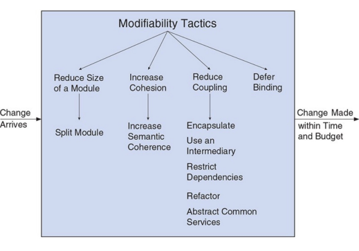
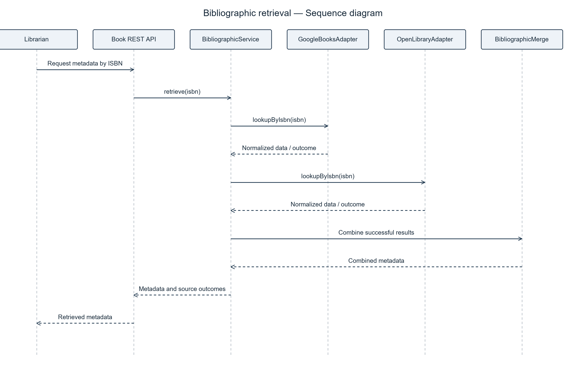
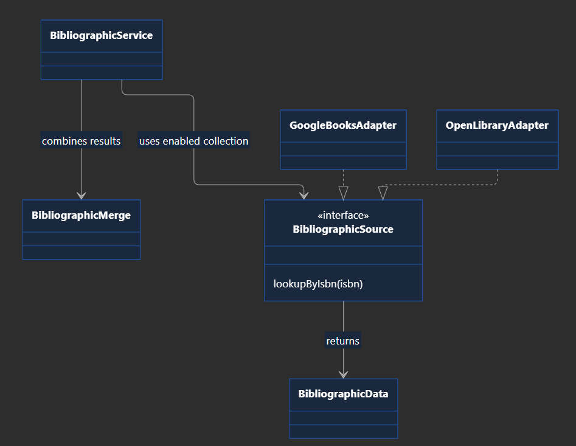
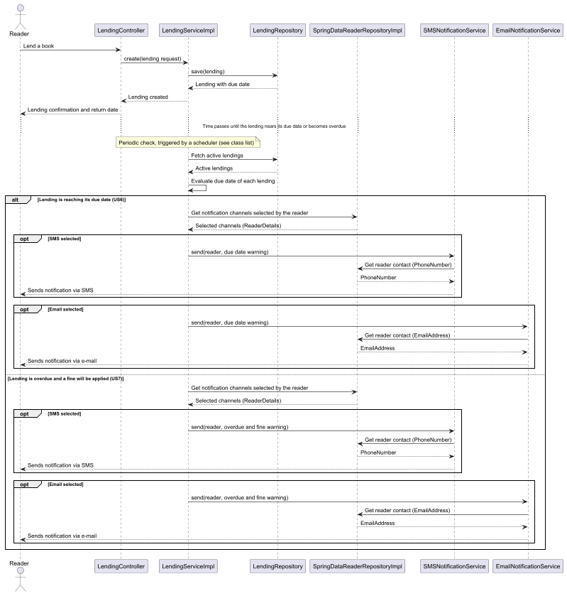
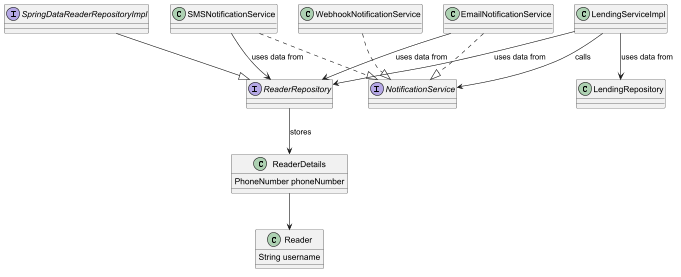

# ADD — Extensibility

Status: proposed design. The current iteration addresses bibliographic sources; notifications and lending policies are planned, not yet designed or implemented.

Requirements and scenarios: [ADD.md](ADD.md). Organization follows the faculty material *Something about Attribute-Driven Design 0.9*, Steps 1–8. The detailed rationale is recorded in the linked technical memo.

## Step 1 — Review inputs

### Requirement

The system must support new bibliographic sources, notification channels and lending policies with limited impact on existing functionality (ARQSOFT 2026-2027 Project 1 for Students 1.1, sections 1.3.3.1–1.3.3.3).

### Variation and evolution points

- Bibliographic sources: Google Books and Open Library now; additional providers later.
- Notification channels: email, SMS and webhook now; additional channels later.
- Lending policies: Standard and Adaptive now; additional policies later.

Retain the existing Java/Spring REST backend. External lending parameter configuration is excluded for this group; automatic policy selection remains included pending faculty confirmation.

## Step 2 — Establish goals and select inputs to be considered in the iteration

### Roadmap

| Iteration   | Goal | Drivers / Related requirements | Design concepts to consider |
|-------------|---|---|---|
| Iteration 1 | Allow new bibliographic sources to be added with limited impact on existing book functionality. | QAS1 — Extensibility; US4. Related: US1, US3, US5, QAS4, QAS9 | Common source interface, Adapter, coordinator, normalized data, deterministic merge, setup-time binding, dependency injection |
| Iteration 2 | Support new notification channels with limited impact on existing functionality. | QAS2 — Extensibility; US6, US7. Related: US9, QAS5, QAS10 | Common channel interface, dispatcher, setup-time binding, dependency injection |
| Iteration 3 | Add lending policies with limited impact on the lending service. | QAS3 — Extensibility; US13, US14. Related: US11, QAS8, QAS11 | Policy interface, Strategy, per-reader selector, controlled clock |

The roadmap is tentative: it orders architectural concerns, not coding stages. Design concepts are candidates to evaluate in each iteration. Only iteration 1 is developed below; later iterations can change as risks and dependencies become clearer.

Each iteration focuses on the extension point of one functional area. Configuration and testability are related concerns within that iteration, not separate bibliographic iterations. Their detailed documentation can be referenced from the corresponding attribute documents when created.

### Iteration 1 — Bibliographic information

Current iteration: Bibliographic information. Primary driver: QAS1. Related drivers: QAS4 and QAS9.

## Step 3 — Choose one or more elements of the system to decompose

### Elements to decompose — Iteration 1

- **Book application service:** introduce bibliographic retrieval coordination alongside existing registration logic.
- **External source integration:** separate each provider's communication and mapping behind a common source interface.
- **Bibliographic data processing:** normalize partial responses and combine results independently of HTTP and persistence.
- **Catalogue registration boundary:** associate metadata with valid internal authors/genre and preserve domain validation.

As-is basis: `BookServiceImpl.create` resolves supplied author identifiers and an existing genre before constructing `Book`. There is no bibliographic provider integration in the current book module. Initial integration may change this code; limited impact applies to subsequent source additions.

## Step 4 — Choose one or more design concepts that satisfy the inputs of the iteration

### Modifiability tactics — Supporting extensibility

The image is a reference catalogue, not a selection of every tactic. Source: the faculty ADD material and the modifiability tactics

#### Selected tactics — Iteration 1

- **Encapsulate / Encapsulation:** hide provider-specific communication and response mapping inside each adapter, limiting the propagation of provider changes (QAS1).
- **Abstract Common Services / Use of Interfaces:** define `BibliographicSource` as a common lookup contract; new providers implement it instead of adding conditions to book business logic (QAS1). These are overlapping descriptions of the same design choice, not two required components.
- **Use an Intermediary:** let `BibliographicService` coordinate the sources through their contract rather than scatter provider calls through book registration (QAS1).
- **Restrict Dependencies:** application clients depend on the source contract; the catalogue domain does not depend on external DTOs or HTTP clients (QAS1).
- **Separation of Concerns:** separate retrieval, external mapping, merge and catalogue persistence so that changing a provider does not require changing unrelated responsibilities (QAS1, QAS9).
- **Defer Binding:** compose the enabled source implementations at setup rather than hard-code the chosen providers in business logic (QAS4). This means setup-time selection, not runtime switching or loading arbitrary new code.

### Other possible tactics

The following concepts are selected as design proposals from the faculty's Tactics (ii), (iii) and (vi). They support the related interoperability, configuration and testing requirements; they do not imply adopting the complete categories.

#### Interoperability tactics — Tactics (ii)

- **Adapter Pattern:** adapt each provider's operations and model to the common source contract (faculty section 1.3.3.1, QAS1).
- **Data Transformation:** translate external fields into partial `BibliographicData`, keeping provider differences outside the catalogue model (US3, QAS9).

#### Flexibility tactics — Tactics (iii)

- **Configuration-Driven Behavior:** enable one or several installed sources through setup configuration, without changing the coordinator (US5, QAS4).
- **Use of Abstractions:** allow provider replacement through the common source interface. This is the same abstraction already selected above, not an additional mechanism (QAS1).

#### Testability tactics — Tactics (vi)

- **Dependency Injection:** supply source implementations to the coordinator so tests can substitute controlled dependencies (QAS9).
- **Isolation:** test provider mapping and merge independently of catalogue persistence and live external systems (QAS9).
- **Mocking:** use mocks/stubs to simulate source outcomes and verify enabled-source calls; adapter tests use controlled HTTP responses where needed (QAS9).

These choices are elaborated as responsibilities and decisions in Step 5 and in the technical memo.

**Proposed choice:** retain the layered backend and use a local source port with provider adapters. Direct provider calls in `BookServiceImpl` are simpler initially but force provider-specific changes into business logic. The selected approach adds types/contracts but isolates variation. See the memo for the full rationale.

## Step 5 — Instantiate architectural elements, allocate responsibilities, and define interfaces

### Tactics and design decisions

| ID | Design decision | Rationale |
|---|---|---|
| EXT-BIB-01 | Define `BibliographicSource` and one adapter per provider; inject sources into a coordinator. | New providers implement a stable contract rather than add provider-specific conditions to book business logic (QAS1). |
| EXT-BIB-02 | Automatically associate only unambiguous existing authors/genre; request librarian completion when necessary. Never create these records automatically. | Reduce manual entry while preserving catalogue identity and the agreed librarian-controlled creation of missing records (US1). |
| EXT-BIB-03 | Translate external responses to partial `BibliographicData`; separate merge logic. | Different models and missing fields remain outside the catalogue domain; merge can be tested without HTTP (US3/QAS9). |
| EXT-BIB-04 | Compose the ordered enabled source collection at setup. | One or several installed sources can be selected without embedding provider names in the coordinator (QAS4). Detailed configuration remains to be refined within iteration 1 and documented under configurability. |
|NOT-MTD-01| `NotificationService` defines general behavior of a notification mechanism; specific implementations of the interface detail the workings of specific mechanisms. | Clients depend on one notification contract rather than on specific mechanisms, so mechanisms can be added or replaced without changing the code that sends notifications (QAS2). |
|NOT-MTD-02| `SMSNotificationService`, `EmailNotificationService` and `WebhookNotificationService` implement `NotificationService` for SMS, email and webhook delivery. | Each mechanism's protocol and delivery details stay in its own class, so a change to one mechanism does not affect the others; covers the three required mechanisms (QAS2). |
|NOT-MTD-03| `LendingServiceImpl` depends only on `NotificationService`, so adding a notification mechanism does not change `LendingServiceImpl`. | Lending business logic contains no mechanism-specific calls or conditions (QAS2); it can be tested with a test double of `NotificationService` instead of real delivery (QAS10). |
|NOT-MTD-04| Notification implementations obtain the reader's contact data through `ReaderRepository`, not its Spring Data implementation: the phone number from `ReaderDetails` and the email from the `username` of its `Reader`. | Notification mechanisms do not depend on the persistence technology, so the repository can be replaced by a test double (QAS10); contact data is read from the existing reader model instead of being duplicated. |

### Constraints

| ID | Constraint | Origin |
|---|---|---|
| CON-BIB-1 | Keep the existing backend and valid `Book` invariants. | Project context and current code |
| CON-BIB-2 | Support Google Books, Open Library, different models and partial data. | Faculty section 1.3.3.1 |
| CON-BIB-3 | Create missing catalogue authors/genres only by explicit librarian decision. | Group decision |
| CON-BIB-4 | Keep provider DTOs/HTTP dependencies outside the domain. | Proposed architectural boundary supporting QAS1/QAS9 |
| CON-NOT-1 | Keep the existing backend. | Project context and current code |
| CON-NOT-2 | Support email, SMS and webhook; notifications may use more than one method at a time. | ADD.md, Reader notifications requirements |
| CON-NOT-3 | Allow the notification systems to be used to be chosen at setup time. | ADD.md, Reader notifications requirements |
| CON-NOT-4 | Use the reader contact data already in the model: phone number in `ReaderDetails`, email as the `username` of `Reader`. | Current code |
| CON-NOT-5 | Keep mechanism-specific dependencies (SMS, email and webhook clients) outside `LendingServiceImpl` and the domain. | Proposed architectural boundary supporting QAS2 |

### Responsibility assignment rationale

| Element | Responsibility / rationale | Properties | Related drivers           |
|---|---|---|---------------------------|
| `BibliographicSource` | Define ISBN lookup and a source identifier. | Common application port | QAS1                      |
| `GoogleBooksAdapter`, `OpenLibraryAdapter` | Query each provider and map its response. | Adapter; infrastructure boundary | QAS1, CON-BIB-2           |
| `BibliographicData` | Carry partial normalized metadata and provenance, not persisted entities. | Provider-independent data | US3, CON-BIB-4            |
| `BibliographicService` | Consult the injected enabled collection, without provider-name conditionals. | Application coordinator/intermediary | QAS1, QAS4                |
| `BibliographicMerge` | Combine normalized results without HTTP or persistence. | Isolated deterministic logic | US3, QAS9                 |
| Setup composition | Supply ordered enabled source implementations. | Spring constructor injection; detailed binding deferred | QAS4                      |
| Book registration | Resolve valid catalogue associations, validate and save. | Existing domain/repository boundaries | US1, CON-BIB-1, CON-BIB-3 |
| `NotificationService` | Define the general behaviour of a notification mechanism. | Common notification contract | QAS2 |
| `SMSNotificationService` | Deliver notifications by SMS, using the reader's phone number from `ReaderDetails`. | Implementation of `NotificationService` | QAS2, CON-NOT-2, CON-NOT-4 |
| `EmailNotificationService` | Deliver notifications by email, using the `username` of the reader's `Reader`. | Implementation of `NotificationService` | QAS2, CON-NOT-2, CON-NOT-4 |
| `WebhookNotificationService` | Deliver notifications by webhook. Source of the webhook target pending. | Implementation of `NotificationService` | QAS2, CON-NOT-2 |
| `LendingServiceImpl` | Trigger notifications through `NotificationService` only, without mechanism-specific calls. | Existing application service | QAS2, CON-NOT-1, CON-NOT-5 |
| `ReaderRepository` | Provide reader contact data to the notification implementations. | Existing repository interface | CON-NOT-4 |

Names are proposed, not existing classes. Suggested placement: contract/data/coordinator in `bookmanagement.services` (optionally a bibliography subpackage), adapters/provider DTOs in `bookmanagement.infrastructure.bibliography`.

### Connection of elements — Interface contracts

| Boundary | Input | Output / obligation |
|---|---|---|
| Source lookup | ISBN | Normalized partial data or explicit no-match/failure outcome; no catalogue writes |
| Coordinator | ISBN and injected sources | Combined data and source outcomes; no automatic author/genre creation |
| Merge | Ordered normalized successful results | Combined data/provenance; precedence/conflict rules pending |
| Registration | Complete required metadata and resolved catalogue associations | Valid saved `Book`, or clear validation response without saving an incomplete book |
| Notification Mehtod | Notification methods a Reader has elected to use | Reader must have selected at least one notification method and have valid contact info petaining to it |
### Technical Memo

[Extensibility — Bibliographic sources](Technical%20Memos/Extensibility/BibliographicSources.md)

[Extensibility — Notification Methods](Technical%20Memos/Extensibility/Notifications.md)

## Step 6 — Sketch views and record decisions

### Sequence sketch — Retrieve bibliographic information

### Structural sketch — Source extension point

**Pending decisions:** matching rules and REST responses; no-match versus provider failure; partial/all-provider failure behaviour; source precedence and conflicting/list values; librarian overrides. Provider schemas/endpoints must be checked against official documentation when implementing. Full ISBN-only completion cannot be guaranteed when required catalogue data is missing.

### Sequence sketch — Notification methods information

### Structural sketch — Notification methods

**Pending decisions:** more notification methods to add; notification method failure behavior.

## Step 7 — Perform analysis of current design and review iteration goal and design objectives

### Design Kanban

This board evaluates the extensibility drivers at design level. Not addressed means no design iteration has developed the driver. Partially addressed means a structural proposal exists but contracts, impact analysis or validation remain incomplete. Addressed means the driver has a sufficiently specified and analysed design solution, not merely that a constraint has been agreed. No extensibility driver is marked addressed yet; implementation and verification are also pending.

| Not addressed | Partially addressed | Addressed in the design |
|---|---|---|
|  | Notification extensibility — QAS2, Bibliographic source extensibility — QAS1: common interface/adapters proposed; contract, registration mechanism and extension impact still need refinement/validation |  |
| Lending policy extensibility — QAS3 | | |

Related concerns: setup-time source selection (QAS4) will be detailed under configurability; test isolation (QAS9) under testability. Partial-data merge (US3) and ISBN-assisted registration (US1) remain functional decisions relevant to this design, not separate extensibility drivers in this board. CON-BIB-3 records the agreed librarian-controlled creation of missing authors/genres; agreeing that constraint does not demonstrate that QAS1 is satisfied.

### Analysis and next verification

- **Iteration goal:** structurally supported by the common port/adapters; QAS1 is not yet verified.
- **Trade-off:** more types and mapping contracts; changes to common data needs may still change clients.
- **Extension experiment:** add a third fake source without changing coordinator/merge/existing adapters, permitting composition and new tests. Record actual changes and regression results.
- **Representative tests:** controlled response mapping, enabled-source calls, agreed merge rules, missing/ambiguous catalogue data, and preservation of manual registration invariants. Use Arrange → Act → Assert.
- **Remaining work:** refine configuration, isolation, contracts and pending behaviours within iteration 1, then implement adapters/coordinator with tests. Subsequent roadmap iterations address notifications and lending policies.

The reported final coverage goal is at least 85%; metric and measured scope still need confirmation. Coverage alone does not verify extensibility or test quality.

## Step 8 — Refine as necessary

After resolving pending decisions and obtaining implementation/test evidence, update the memo, diagrams, Kanban and roadmap. Continue with the next selected drivers; do not mark a proposed structure as a verified result.
