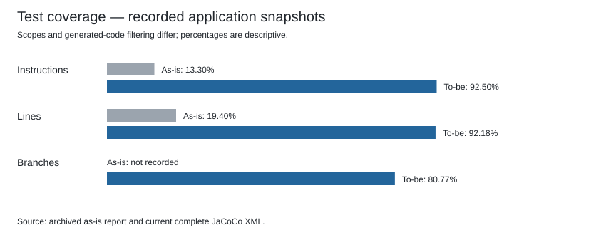

# Test quality — to-be

## Summary

The quality assessment uses 13 deliberately selected active test methods: four author cases, two reader cases, one lending case and six bibliographic cases. It covers retained behaviour and the new bibliographic design. It is not the entire suite or the same 13 methods as the as-is sample; several old author methods were replaced or renamed.

| Metric | As-is | To-be |
|---|---:|---:|
| Reviewed sample size | 13 | 13 |
| Mean reviewed quality (0–10) | 9.74 | 9.92 |
| Full-suite instruction coverage | 13.3% | 92.50% |
| Full-suite line coverage | 19.4% | 92.18% |
| Full-suite branch coverage | Not recorded | 80.77% |

The baseline already had a high subjective sample score despite low whole-suite coverage. The sample mean therefore must not be used as evidence that the whole suite is strong. Samples, Java versions, production scope and generated-code filtering differ; read the [comparison limits](README.md#comparison-limits).

## Same eight criteria

- Functional coverage: 10 if the reviewed assertions check the stated objective; otherwise 0. This is a manual review score, distinct from JaCoCo coverage.
- No duplication: 10 for a distinct reviewed scenario, otherwise 0. Review is scoped to the sample, not a proof of zero overlap throughout the repository.
- Reproducibility: 10 if all three consecutive local runs pass, otherwise 0.
- Clarity: 10 if the method name and readable test body make the purpose clear, otherwise 0, as in the baseline.
- Independence: 10 if the reviewed case builds/resets its state and does not change other cases, otherwise 0.
- Performance: as-is bands applied to mean Surefire method time: up to 0.3s → 10; 0.6s → 9; 0.9s → 8; 1.2s → 7; above 3s → 3. The baseline defines no band between 1.2s and 3s; the collector rejects that gap rather than inventing a score.
- Flakiness: 10 if none of the three local observations fails, otherwise 0. This overlaps reproducibility in the original rubric; three runs cannot establish universal stability.
- Maintainability: mean of no duplication and independence, following the as-is formula. It is a limited proxy, not a complete maintenance assessment.

## Reviewed methods

| Class and method | Three observed durations (ms), execution order | Mean score |
|---|---|---:|
| `AuthorTest#newAuthorKeepsItsNameBioAndPhoto` | 692, 656, 194 | 9.88 |
| `AuthorTest#nameIsMandatory` | 2, 1, 2 | 10.00 |
| `AuthorTest#bioIsMandatory` | 2, 3, 2 | 10.00 |
| `AuthorTest#patchWithAStaleVersionIsRejectedAndChangesNothing` | 6, 6, 7 | 10.00 |
| `ReaderTest#ensurePhotoCanBeNull_AkaOptional` | 3, 3, 2 | 10.00 |
| `ReaderTest#ensureValidPhoto` | 5, 3, 3 | 10.00 |
| `LendingTest#testSetReturned` | 1, 2, 1 | 10.00 |
| `BibliographicCoreTest#priorityFallbackProvenanceAndAuthorConflict` | 3, 3, 5 | 10.00 |
| `BibliographicCoreTest#failureDoesNotDiscardSuccessfulPartialData` | 8, 9, 10 | 10.00 |
| `BibliographicCoreTest#noMatchDiffersFromFailedLookup` | 2, 2, 2 | 10.00 |
| `BibliographicCoreTest#invalidIsbnNeverCallsProviders` | 9, 9, 14 | 10.00 |
| `BibliographicCoreTest#extensionAndOrderDoNotRequireCoordinatorChanges` | 4107, 3770, 4623 | 9.12 |
| `BibliographicRegistrationServiceTest#previewReturnsLookupAndResolutionWithoutWriting` | 27, 28, 29 | 10.00 |

## Per-method review evidence

### AuthorTest — newAuthorKeepsItsNameBioAndPhoto

[Source code](../../../../src/test/java/pt/psoft/g1/psoftg1/authormanagement/model/AuthorTest.java). Constructor preserves name, biography, photo and initial version.

Scores in criterion order (functional, no duplication, reproducibility, clarity, independence, performance, flakiness, maintainability): 10, 10, 10, 10, 10, 9, 10, 10.

Observed statuses: passed, passed, passed.

### AuthorTest — nameIsMandatory

[Source code](../../../../src/test/java/pt/psoft/g1/psoftg1/authormanagement/model/AuthorTest.java). Null and blank author names are rejected.

Scores in criterion order (functional, no duplication, reproducibility, clarity, independence, performance, flakiness, maintainability): 10, 10, 10, 10, 10, 10, 10, 10.

Observed statuses: passed, passed, passed.

### AuthorTest — bioIsMandatory

[Source code](../../../../src/test/java/pt/psoft/g1/psoftg1/authormanagement/model/AuthorTest.java). Null and blank biographies are rejected.

Scores in criterion order (functional, no duplication, reproducibility, clarity, independence, performance, flakiness, maintainability): 10, 10, 10, 10, 10, 10, 10, 10.

Observed statuses: passed, passed, passed.

### AuthorTest — patchWithAStaleVersionIsRejectedAndChangesNothing

[Source code](../../../../src/test/java/pt/psoft/g1/psoftg1/authormanagement/model/AuthorTest.java). Stale version is rejected and aggregate fields remain unchanged.

Scores in criterion order (functional, no duplication, reproducibility, clarity, independence, performance, flakiness, maintainability): 10, 10, 10, 10, 10, 10, 10, 10.

Observed statuses: passed, passed, passed.

### ReaderTest — ensurePhotoCanBeNull_AkaOptional

[Source code](../../../../src/test/java/pt/psoft/g1/psoftg1/readermanagement/model/ReaderTest.java). Reader photo is optional.

Scores in criterion order (functional, no duplication, reproducibility, clarity, independence, performance, flakiness, maintainability): 10, 10, 10, 10, 10, 10, 10, 10.

Observed statuses: passed, passed, passed.

### ReaderTest — ensureValidPhoto

[Source code](../../../../src/test/java/pt/psoft/g1/psoftg1/readermanagement/model/ReaderTest.java). Reader photo path is preserved; non-null is checked before dereference.

Scores in criterion order (functional, no duplication, reproducibility, clarity, independence, performance, flakiness, maintainability): 10, 10, 10, 10, 10, 10, 10, 10.

Observed statuses: passed, passed, passed.

### LendingTest — testSetReturned

[Source code](../../../../src/test/java/pt/psoft/g1/psoftg1/lendingmanagement/model/LendingTest.java). Return date equals the explicit fixed date supplied to the operation.

Scores in criterion order (functional, no duplication, reproducibility, clarity, independence, performance, flakiness, maintainability): 10, 10, 10, 10, 10, 10, 10, 10.

Observed statuses: passed, passed, passed.

### BibliographicCoreTest — priorityFallbackProvenanceAndAuthorConflict

[Source code](../../../../src/test/java/pt/psoft/g1/psoftg1/bibliographicmanagement/BibliographicCoreTest.java). Merge asserts priority, fallback, provenance, genre normalization and author-conflict warning.

Scores in criterion order (functional, no duplication, reproducibility, clarity, independence, performance, flakiness, maintainability): 10, 10, 10, 10, 10, 10, 10, 10.

Observed statuses: passed, passed, passed.

### BibliographicCoreTest — failureDoesNotDiscardSuccessfulPartialData

[Source code](../../../../src/test/java/pt/psoft/g1/psoftg1/bibliographicmanagement/BibliographicCoreTest.java). Partial success survives another source failure and reports an incomplete-lookup warning.

Scores in criterion order (functional, no duplication, reproducibility, clarity, independence, performance, flakiness, maintainability): 10, 10, 10, 10, 10, 10, 10, 10.

Observed statuses: passed, passed, passed.

### BibliographicCoreTest — noMatchDiffersFromFailedLookup

[Source code](../../../../src/test/java/pt/psoft/g1/psoftg1/bibliographicmanagement/BibliographicCoreTest.java). No match is distinguished from incomplete lookup.

Scores in criterion order (functional, no duplication, reproducibility, clarity, independence, performance, flakiness, maintainability): 10, 10, 10, 10, 10, 10, 10, 10.

Observed statuses: passed, passed, passed.

### BibliographicCoreTest — invalidIsbnNeverCallsProviders

[Source code](../../../../src/test/java/pt/psoft/g1/psoftg1/bibliographicmanagement/BibliographicCoreTest.java). Invalid ISBN is rejected before source or merge interactions.

Scores in criterion order (functional, no duplication, reproducibility, clarity, independence, performance, flakiness, maintainability): 10, 10, 10, 10, 10, 10, 10, 10.

Observed statuses: passed, passed, passed.

### BibliographicCoreTest — extensionAndOrderDoNotRequireCoordinatorChanges

[Source code](../../../../src/test/java/pt/psoft/g1/psoftg1/bibliographicmanagement/BibliographicCoreTest.java). Selection accepts a third registration, preserves order and returns an immutable list without provider calls.

Scores in criterion order (functional, no duplication, reproducibility, clarity, independence, performance, flakiness, maintainability): 10, 10, 10, 10, 10, 3, 10, 10.

Observed statuses: passed, passed, passed.

### BibliographicRegistrationServiceTest — previewReturnsLookupAndResolutionWithoutWriting

[Source code](../../../../src/test/java/pt/psoft/g1/psoftg1/bibliographicmanagement/BibliographicRegistrationServiceTest.java). Preview returns lookup/catalogue results without book-service or repository writes.

Scores in criterion order (functional, no duplication, reproducibility, clarity, independence, performance, flakiness, maintainability): 10, 10, 10, 10, 10, 10, 10, 10.

Observed statuses: passed, passed, passed.

Surefire times can include class initialization, Mockito instrumentation and fixture setup. A slow first use of mocks is not evidence that the source-selection algorithm itself is slow; the score follows the recorded method duration, as in the baseline.

`testSetReturned` retains a generic name; its body states the fixed-date expectation, meeting the same clarity standard used for this name in the baseline. It creates a new lending per test; shared fixed book/reader fixtures are not modified by this operation. Author/reader construction executes real value objects, so these tests are not strict single-production-class isolation merely because they avoid Spring.

Bibliographic boundaries: merge and selection use fixed data; invalid-ISBN verification executes the real ISBN validator and is a small collaboration. Preview uses a real registration service with mocked lookup, matcher, book service and repository, and explicitly verifies no writes. The extension case exercises SourceSelection; its name is not evidence of a real coordinator collaboration. Separate integration tests cover real wiring and HTTP workflows.

## Coverage from the complete functional run

| Scope | Instructions | Lines | Branches |
|---|---|---|---|
| Entire production project | 15067/16289 (92.50%) | 3031/3288 (92.18%) | 1088/1347 (80.77%) |
| Bibliographic packages | 1788/1836 (97.39%) | 361/366 (98.63%) | 205/242 (84.71%) |

Coverage combines unit and integration execution snapshots once, through the existing global JaCoCo helper. It is an exercised-code measure, not an assertion-quality guarantee.

## Mutation evidence — bibliographic scope only

Fresh PIT run: 124 generated mutants; 118 killed (95.16% of all generated mutants). Status counts: KILLED=118, NO_COVERAGE=2, SURVIVED=4.

Scope: BibliographicMerge, SourceSelection, AuthorCorrespondence, CatalogueMatcher, BibliographicRegistrationService, GoogleBooksAdapter, OpenLibraryAdapter, GoogleBooksMapper and OpenLibraryMapper, with the six test classes selected by the bibliographic Maven profile. This is not a whole-project mutation score. Surviving and uncovered mutants remain investigation candidates; no 100% score is claimed.

## Remaining limitations

- Full-suite stability has one measured execution; the three consecutive executions cover only the reviewed sample classes.
- Review surviving/uncovered mutants before deciding whether a new assertion, a new case or an equivalent-mutant justification is needed.
- External providers are replaced by local doubles. The results do not establish live Google Books/Open Library availability or deployment correctness.
- Some tests remain small collaborations, shared fixed fixtures exist, and the filename convention does not establish test isolation.
- Preserve the baseline unchanged; use a matched production scope/filtering and identical sample to support a controlled before/after claim.

See [reproduction commands](README.md) and [machine-readable evidence](metrics.json).
