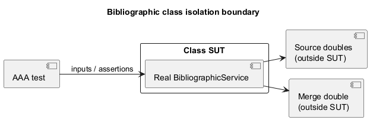
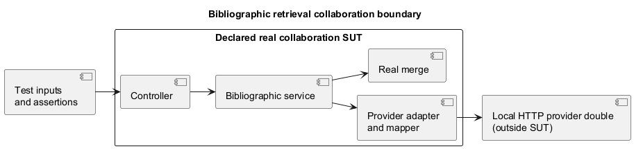

# ADD — Testability

Requirements and scenarios: ADD.md. Organization follows the faculty material Something about Attribute-Driven Design 0.9, Steps 1–8. The detailed rationale is recorded in the linked technical memos.

## Step 1 — Review inputs

### Requirement

ProjectStatement.pdf, section 1.3.3.4, requires:

- Functional opaque-box tests with SUT = classes;
- Functional transparent-box tests with SUT = domain classes; 
- Mutation tests with SUT = classes; 
- Opaque-box tests with SUT = controller + service + {domain, repository, gateways}; 
- Opaque-box tests with SUT = system. 

Tests should primarily cover new functionality and prioritize quality and representativeness.

For bibliographic information, QAS9 requires controlled source responses, isolated mapping/merge tests and no real external calls. US1/US3 concern ISBN-assisted registration and combining partial information; US5/QAS4 require selecting sources at setup.

### Current limitations

- `BookServiceImpl.create` resolves authors/genre, constructs a real `Book` and saves it through the repository. No `BookServiceImplTest` was found in the current test tree. Future tests must explicitly define which collaborators are real and which are replaced before claiming a single-class SUT.
- The bibliographic contract, coordinator, adapters and merge are design proposals, not implemented classes in the current source tree.
- Current `AuthorTest` constructs `Author`, which creates `Name`, `Bio` and photo-related objects internally. Under the single-class SUT criterion reported from class, these real collaborations must be distinguished from isolated class tests. A test of `EntityWithPhoto` is also located in that test class.
- Some existing tests start Spring and replace repositories with mocks. An annotation or test name does not determine the SUT. Their actual real collaborators and assertions must be inspected.

### SUT convention for this project

For a class-isolation test, identify one real production class as SUT and control its behavioural collaborators. Test collaborating production classes individually before verifying their real collaboration. If a helper/mapper/transport/domain class executes real behaviour relevant to the test, declare the broader boundary and classify it as collaboration/integration rather than claim single-class isolation.

Plain input/output fixtures and standard library/framework execution must be distinguished from application collaborators; document the boundary rather than claiming that only one object can exist. A typed variable (`Author author`) or typed constructor parameters alone do not prove isolation. Receiving already prepared `Name`/`Bio` can expose dependencies, but the actual executed behaviour and constructor invariants still matter. Do not mock the SUT or weaken invariants just to label a test unitary.

## Step 2 — Establish goals and select inputs to be considered in the iteration

### Roadmap

| Iteration | Goal | Drivers / Related requirements | Design concepts to consider |
|---|---|---|---|
| Iteration 1 | Make bibliographic classes and their collaboration testable with controlled data, without live provider dependencies. | QAS9 — Testability; US1, US3. Related: US5/QAS4 and section 1.3.3.4 | Explicit SUT boundaries, dependency injection, isolated mapping/merge, HTTP doubles, AAA, mutation analysis |
| Iteration 2 | Verify notification dispatch and channels without sending real messages. | QAS10 — Testability; US6, US7, US9; US8 remains proposed scope | Channel doubles, recording interactions, transport boundaries |
| Iteration 3 | Verify policies and per-reader selection with controlled dates and history. | QAS11 — Testability; US11, US13, US14 | Policy isolation, controlled clock, history doubles, boundary cases |

The roadmap groups testing-related architectural concerns, not test counts. External configuration of lending parameters remains excluded; automatic policy selection remains included pending faculty confirmation.

### Iteration 1 — Bibliographic information

Primary driver: QAS9. Goal: specify observable contracts and replaceable dependencies so class tests can precede tests of real collaboration, followed by system tests. Preserve the source interface and catalogue rules agreed in extensibility.

## Step 3 — Choose one or more elements of the system to decompose

### Elements to analyse — Iteration 1

- **Bibliographic coordinator:** isolate source selection/coordination from real providers and merge behaviour.
- **Provider adapters and mapping:** expose HTTP/response mapping dependencies to test each production class separately before combining them.
- **Merge logic:** separate data combination from HTTP, persistence and framework startup.
- **Catalogue registration:** identify which class enforces each rule and where real author/genre/domain interactions enter the test boundary.
- **Book REST workflow:** define a larger integration SUT and a running-system SUT after class behaviour is covered.

This refines the design in Extensibility.md; it is not a refactoring of all existing modules or a requirement to create interfaces for every data class.

## Step 4 — Choose one or more design concepts that satisfy the inputs of the iteration

### Design alternatives — Iteration 1

Question: how can we control provider communication when testing each bibliographic adapter independently (QAS9)? Both alternatives retain the required class, collaboration, domain, mutation and system test categories.

| Alternative | Organization | Benefits | Costs / limitations |
|---|---|---|---|
| A — Inject the HTTP client's existing contract | Supply the selected HTTP client to the adapter and replace it in isolated tests. | Fewer application abstractions; uses an existing client API. | Tests may depend on client-specific call chains; changing clients can affect adapters and tests. Feasibility depends on the client chosen. |
| B — Inject a small application-owned transport contract | Give adapters a narrow request/response transport interface; a production implementation uses the HTTP client. Tests substitute that interface. | Simple controlled responses/errors; isolates adapter tests from HTTP-client details. | One extra interface and implementation; real transport integration still needs testing. |

### Selected alternative — B

B is the proposed design: a small shared transport contract makes provider responses and failures easy to control without exposing HTTP-client details in adapter class tests. The cost is an additional boundary to maintain. Keep it limited to the operations actually needed; its exact signature and HTTP client remain pending.

Test each adapter with a transport double and controlled mapping collaborators where applicable. Then test the real adapter, mapper and transport together against a local HTTP provider double. Test the running API separately. Source and merge dependencies of the coordinator are also injected, as already proposed in extensibility. Neither alternative removes required testing categories or replaces the real SUT with a mock.

The tactics below support B and the broader test-boundary design. They work together; they are not additional competing alternatives.

### Testability tactics — Supporting bibliographic testing

Source: faculty ADD material — Testability Tactics catalogue and Tactics (vi). Only the relevant tactics are selected below.

#### Selected catalogue tactics — Iteration 1

- **Abstract Data Sources:** use the source interface and proposed transport contract to supply controlled bibliographic data and errors instead of contacting live providers (QAS9).
- **Limit Structural Complexity:** separate coordination, provider mapping, merge and persistence so each responsibility has a clear test boundary (QAS9).
- **Limit Nondeterminism:** use fixed inputs/responses and an explicit source order; simulate failures instead of depending on network timing or changing provider data. Final merge rules still need agreement (QAS9).
- **Executable Assertions:** check expected fields, errors and relevant interactions with assertions that fail when the observed behaviour is wrong (QAS9).
- **Sandbox:** run broader tests with local provider doubles and separate test data/storage where needed. The real backend components inside the declared SUT still execute (QAS9).

#### Practical techniques — Faculty Tactics (vi)

- **Dependency Injection:** pass behavioural collaborators explicitly so tests can supply controlled replacements.
- **Isolation:** execute class tests without Spring, persistence or live provider access; use real collaboration in separately declared broader SUTs.
- **Mocking:** use mocks/stubs for collaborators while keeping the class under test real.

These techniques put the catalogue tactics into practice. Logging can help diagnose failures, but is optional supporting instrumentation and does not replace assertions. Fixed response fixtures are not claimed as a full Record/Playback mechanism.

### Supporting tactics and concepts

- **Separation of Concerns / Encapsulation:** keep provider communication, mapping and merge behind explicit boundaries.
- **Use of Interfaces:** reuse the source contract and add only the narrow transport boundary justified above; other interfaces need a concrete substitution need.
- **Controllability and observability:** tests supply known inputs and verify public outputs, errors or relevant side effects without exposing private state solely for tests.

## Step 5 — Instantiate architectural elements, allocate responsibilities, and define interfaces

### Tactics and design decisions

| ID | Design decision | Rationale |
|---|---|---|
| TST-BIB-01 | Declare the SUT and real/replaced collaborators for every test group. | Prevent class tests from silently becoming real multi-class tests; follow the classroom convention. |
| TST-BIB-02 | Inject sources and merge; give provider adapters a narrow application-owned transport contract and controlled mapping collaborators where applicable. | Control responses/errors without coupling isolated adapter tests to HTTP-client internals (QAS9). Test the real transport separately and with adapters. |
| TST-BIB-03 | Use fixed provider-response fixtures and observable normalized results/outcomes. | Reproduce partial/invalid responses and verify mapping without relying on changing remote data. |
| TST-BIB-04 | Separate class, collaboration and system test groups; exercise the real production composition in broader tests. | Isolation alone cannot reveal wiring or contract incompatibilities (section 1.3.3.4). |
| TST-BIB-05 | Design representative cases with AAA and meaningful assertions, then analyse coverage and mutants. | Detect wrong behaviour rather than merely execute lines or count tests. |

### Constraints

| ID | Constraint | Origin |
|---|---|---|
| CON-TST-1 | Represent all five requested testing categories, with transparent-box testing restricted to relevant domain classes. | Section 1.3.3.4 |
| CON-TST-2 | Bibliographic automated tests use controlled providers, not live Google/Open Library services. | QAS9 |
| CON-TST-3 | New author/genre records require explicit librarian action; incomplete books must not be saved. | US1 acceptance criteria / EXT-BIB-02 |
| CON-TST-4 | Explicitly distinguish a single-class SUT from real application-class collaboration. | Reported classroom guidance |
| CON-TST-5 | Preserve domain invariants while making dependencies explicit; no blanket mocking or weakening validation for coverage. | Proposed design safeguard |

### Responsibility assignment rationale

| Element | Responsibility / rationale | Properties | Related drivers |
|---|---|---|---|
| `BibliographicService` | Coordinate enabled sources and merge through replaceable contracts. | Single real coordinator in isolated tests | QAS9, CON-TST-4 |
| Provider adapter | Convert the lookup operation into a provider interaction and use controlled mapping/transport. | Adapter; exact collaborators to finalize | QAS9, CON-TST-2 |
| Provider mapper, if extracted | Translate provider fields to normalized partial metadata. | Test separately before adapter + mapper integration | QAS9, CON-TST-4 |
| `BibliographicMerge` | Apply agreed data precedence/combination without HTTP/persistence. | Deterministic class SUT | US3, QAS9 |
| Test fixtures and doubles | Supply explicit inputs and record relevant interactions. | Test-only code; no substitute for exercising the real SUT | CON-TST-2, CON-TST-4 |
| Registration domain classes | Enforce the rules assigned to each domain class. | Transparent-box candidates where actually affected | CON-TST-1, CON-TST-3 |

Names and proposed separations are not implemented contracts. Adapter/mapper/transport boundaries must be finalized before claiming isolated class coverage.

### SUT boundaries and test categories

| Category | SUT / real production elements | Controlled outside the boundary | Verification |
|---|---|---|---|
| Functional opaque-box — classes | One coordinator, merge, mapper or adapter class at a time | Behavioural collaborators replaced; explicit data fixtures | Public contract, accepted/rejected cases, missing fields and outcome handling |
| Functional transparent-box — domain classes | One relevant affected domain class at a time | Collaborators prepared/controlled according to the classroom boundary | Cases derived from branches and boundaries of actual domain rules; outputs/exceptions remain the oracle |
| Mutation — classes | Selected new/changed class behaviour exercised by functional tests | Same controlled dependencies | Whether assertions detect changed mapping, predicates or merge choices |
| Functional opaque-box — collaboration | Controller + real service + selected real domain/repository/gateway components; explicitly list included components for each suite | Remote provider replaced by local HTTP double; dedicated test database when real repository included | Real calls, wiring, mapping and persistence effects; test the included classes separately first |
| Functional opaque-box — system | Running backend through HTTP, including security, configuration and persistence | Remote providers controlled; independent test data/storage | End-to-end retrieval/registration results and relevant error responses |

Class isolation does not mean every DTO must become an interface. If its constructor performs application validation/mapping relevant to the test, document and separate that behaviour or classify the wider SUT honestly. HTTP-double tests involving a real adapter, mapper and client are collaboration tests, not a single-class adapter test.

Bibliographic infrastructure is not domain merely because it contains branches. Do not invent a domain entity just to fill the transparent-box category. Identify affected domain rules during registration integration; if this iteration changes none, record that fact and cover new policy/domain rules in the later iteration.

### Planned cases — Arrange, Act, Assert

| Case | SUT / level | Arrange → Act → Assert |
|---|---|---|
| Enabled sources only | Coordinator / class | Prepare source doubles and merge double → retrieve ISBN → assert the specified result, calls to enabled sources and no calls to disabled sources. |
| Partial response | Provider mapper / class | Supply a fixed response missing optional fields → map → assert exact available/missing values and provenance. |
| Data combination | Merge / class | Prepare partial normalized inputs → combine → assert field selection after precedence/list rules are agreed. |
| No match versus failure | Adapter/coordinator / separate class tests | Supply controlled no-match/error outcomes → execute → assert their distinct agreed contracts. |
| Missing catalogue association | Registration collaboration | Provide metadata without a required association → submit → assert completion/error response and no book/author/genre created implicitly. |
| Complete registration | Registration collaboration/system | Prepare valid data, existing associations and controlled provider responses → submit → assert persisted book and API result; no extra completion when unambiguous. |

Do not assert only `notNull`, hide the sole assertion inside an optional branch, or assert a value computed by the same production logic. For expected errors, the Act may be inside `assertThrows`; AAA need not be three literal code blocks. Opaque versus transparent describes how cases are derived, not whether the SUT runs real code.

### Tools and acceptance evidence

- Existing JUnit/Mockito facilities are candidates for class tests; Spring test support for real collaboration. Select a local HTTP double when provider-client boundaries are finalized.
- Surefire executes the configured test selection; Failsafe can separate integration execution if explicitly configured. A test filename alone is not SUT evidence.
- JaCoCo measures exercised code. The reported final target is at least 85%; line coverage is the current assumption and measurement scope still needs confirmation. QAS9's 80% branch target is a separate group proposal.
- PIT mutation testing requires later configuration. Surviving mutants are not failing functional tests; mutation score and any exclusions require explicit justified criteria.
- Tests of error paths must pass when expected rejection occurs. No rule accepting integration failures is set here: any faculty-required tolerance needs a separately agreed criterion.

### Technical Memo

[Testability — Bibliographic sources](Technical%20Memos/Testability/BibliographicSources.md)

## Step 6 — Sketch views and record decisions

### Class isolation boundary

### Collaboration boundary

The second sketch concerns retrieval; registration suites extend the declared SUT with the relevant domain and repository components. System tests invoke a running backend via HTTP instead of invoking the controller directly. These are test-boundary sketches, not replacements for full implementation views.

## Step 7 — Perform analysis of current design and review iteration goal and design objectives

### Design Kanban

The columns are independent status lists: cells on the same row are not related. This board tracks testability design in this document, not implemented tests or design work in other documents.

| Not addressed | Partially addressed | Addressed in the design |
|---|---|---|
| Notification testability — QAS10 | Bibliographic isolation — QAS9: SUT boundaries, tactics and test categories proposed; concrete contracts, fixture examples and expected results still need refinement |  |
| Lending policy testability — QAS11 | | |

## Step 8 — Refine as necessary

Resolve the pending contracts with concrete examples; update the memo and boundary sketches; implement a small class-level case and then its collaboration test. Refine existing tests only where relevant, without mass-refactoring every module. Continue with notification and lending iterations after reviewing their drivers.
