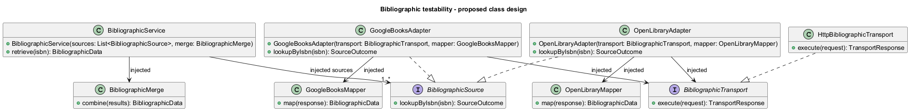
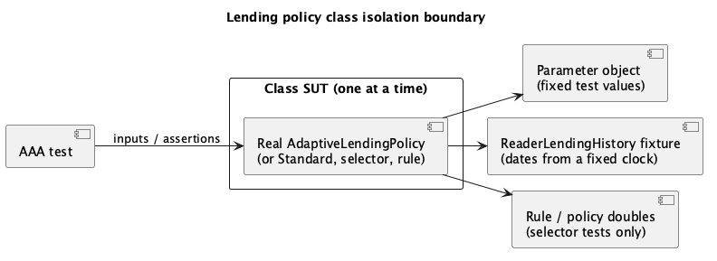
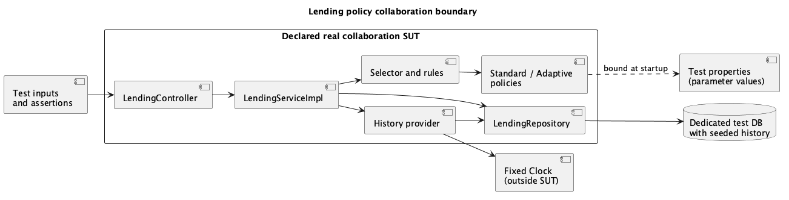

# ADD — Testability

Requirements and scenarios: ADD.md. Organization follows the faculty material Something about Attribute-Driven Design 0.9, Steps 1–8. The detailed rationale is recorded in the linked technical memos.

## Step 1 — Review inputs

### Requirement

ProjectStatement.pdf section 1.3.3.4 supplies the verification constraints; its class, domain, mutation, collaboration and system scopes are detailed in Step 5. They guide verification of this design, rather than prescribe its class structure.

For bibliographic information, QAS9 requires controlled source responses and independently testable mapping and merge behaviour. The architectural goal is to make behavioural dependencies explicit and replaceable, while keeping provider communication and data transformation separate (US1/US3; related US5/QAS4).

For lending policies, QAS11 requires each policy rule, the parameter constraints, renewals and per-reader selection to be verified with injected parameters and a controllable clock, without starting Spring or the database for class tests. US10/QAS7 add startup validation of configured parameters; US11/US13/US14 and rules LP-S, LP-A, LP-SEL and LP-CFG in [ADD.md](ADD.md) define the expected behaviour.

### Current limitations

- `BookServiceImpl.create` resolves authors/genre, constructs a real `Book` and saves it through the repository. No `BookServiceImplTest` was found in the current test tree. Future tests must explicitly define which collaborators are real and which are replaced before claiming a single-class SUT.
- The bibliographic contract, coordinator, adapters and merge are design proposals, not implemented classes in the current source tree.
- `Author` constructs `Name` and `Bio` internally. Under the classroom single-class SUT convention, tests exercising this construction include real collaborators. This observation motivates explicit dependencies, but the proposed bibliographic design does not require changing the `Author` constructor.
- `AuthorViewMapper` is used by the controller to build API views and HTTP links. This placement matches its responsibility and is not itself a testability defect. No relocation of existing REST mappers is required by this bibliographic iteration; provider response mapping is handled separately beside the external adapters.
- Some existing tests start Spring and replace repositories with mocks. An annotation or test name does not determine the SUT. Their actual real collaborators and assertions must be inspected.
- Lending: `LendingTest` reads `config/library.properties` through `@PropertySource` and asserts against `LocalDate.now()`; `LendingServiceImplTest` and `LendingRepositoryIntegrationTest` use `@SpringBootTest` and real-date values. Date-dependent results therefore change with the day the tests run, and no lending rule can be tested without the full context. The policy contract, selector, history snapshot and parameter objects are design proposals, not implemented classes.

### SUT convention for this project

For a class-isolation test, identify one real production class as SUT and control its behavioural collaborators. Test collaborating production classes individually before verifying their real collaboration. If a helper/mapper/transport/domain class executes real behaviour relevant to the test, declare the broader boundary and classify it as collaboration/integration rather than claim single-class isolation.

Plain input/output fixtures and standard library/framework execution must be distinguished from application collaborators; document the boundary rather than claiming that only one object can exist. A typed variable (`Author author`) or typed constructor parameters alone do not prove isolation. Receiving already prepared `Name`/`Bio` can expose dependencies, but the actual executed behaviour and constructor invariants still matter. Do not mock the SUT or weaken invariants just to label a test unitary.

## Step 2 — Establish goals and select inputs to be considered in the iteration

### Roadmap

| Iteration | Goal | Drivers / Related requirements | Design concepts to consider |
|---|---|---|---|
| Iteration 1 | Make bibliographic classes and their collaboration testable with controlled data, without live provider dependencies. | QAS9 — Testability; US1, US3. Related: US5/QAS4 and section 1.3.3.4 | Explicit SUT boundaries, dependency injection, isolated mapping/merge, HTTP doubles, AAA, mutation analysis |
| Iteration 2 | Verify notification dispatch and channels without sending real messages. | QAS10 — Testability; US6, US7, US9; US8 remains proposed scope | Channel doubles, recording interactions, transport boundaries |
| Iteration 3 | Verify policies, parameter validation and per-reader selection with controlled dates and history. | QAS11 — Testability; US10, US11, US13, US14. Related: QAS3, QAS7, QAS8 | Policy isolation, controlled clock, history fixtures, boundary cases, startup validation tests |

The roadmap groups testing-related architectural concerns, not test counts. Lending parameters are externally configured (QAS7), so parameter validation is tested in isolation; automatic policy selection remains included pending faculty confirmation.

### Iteration 1 — Bibliographic information

QAS9 is the main requirement guiding the design choices in this iteration. Goal: separate coordination, provider communication, mapping and merge, and receive their behavioural dependencies through constructors. Preserve the source interface and catalogue rules agreed in extensibility.

### Iteration 3 — Lending policies

QAS11 is the main requirement guiding the design choices in this iteration. Related drivers: QAS3 (adding a policy), QAS7 (parameter configuration), QAS8 (per-reader selection). Goal: make every lending rule, parameter constraint and selection condition verifiable with fixed dates, prepared histories and explicit parameter values, first per class and then in real collaboration. Preserve the policy contract, selector and history snapshot agreed in [Extensibility.md](Extensibility.md) and the parameter binding in [Configurability.md](Configurability.md).

Selection rationale: lending rules are date-dependent and currently only testable with the full Spring context and the real clock. They also contain most of the new domain logic of this project, so they are the main source of transparent-box and mutation evidence (section 1.3.3.4).

## Step 3 — Choose one or more elements of the system to decompose

### Elements to analyse — Iteration 1

- **Bibliographic coordinator:** isolate source selection/coordination from real providers and merge behaviour.
- **Provider adapters and mapping:** expose HTTP/response mapping dependencies to test each production class separately before combining them.
- **Merge logic:** separate data combination from HTTP, persistence and framework startup.
- **Catalogue registration:** identify which class enforces each rule and where real author/genre/domain interactions enter the test boundary.
- **Book REST workflow:** define a larger integration SUT and a running-system SUT after class behaviour is covered.

This refines the design in Extensibility.md; it is not a refactoring of all existing modules or a requirement to create interfaces for every data class.

### Elements to analyse — Iteration 3

- **Policies (`StandardLendingPolicy`, `AdaptiveLendingPolicy`):** pure rule evaluation over a history snapshot and a parameter object; the main class and mutation SUTs.
- **Parameter objects:** constructor validation of the specification constraints (2.x, 3.5, 4.2); domain-like rules suitable for transparent-box tests.
- **Selector and selection rules:** ordered evaluation and Standard default; boundary cases of LP-SEL1.
- **History provider:** translation of stored lendings into the snapshot using the injected clock; needs a repository double or a test database.
- **`Lending` entity:** limit date, overdue days and fines currently computed with `LocalDate.now()`; affected domain class for transparent-box tests once the date is supplied.
- **`LendingServiceImpl` and REST workflow:** delegation, rejection reason and persistence; collaboration and system SUTs.

## Step 4 — Choose one or more design concepts that satisfy the inputs of the iteration

### Design alternatives — Iteration 1

Question: how should bibliographic classes obtain their collaborators so each responsibility can be exercised with controlled inputs and failures (QAS9)? These are alternatives for the new design; internal dependency creation is not claimed to exist in unimplemented bibliographic classes.

| Alternative | Description | Benefits | Costs / limitations |
|---|---|---|---|
| A — Create collaborators internally | The coordinator constructs sources/merge; adapters construct their transport and mapping dependencies. | Less startup composition | Tests cannot easily replace these dependencies; responsibilities and construction are coupled |
| B — Receive collaborators through constructors | Setup composes the objects; the service receives sources/merge and each adapter receives transport and its provider mapper. | Explicit dependencies; independent control of communication, mapping and coordination | More composition and contracts; real collaboration must also be tested |

**Proposed choice:** B. Reuse `BibliographicSource`, extract provider mapping into dedicated classes, and use a narrow `BibliographicTransport` contract implemented by an HTTP transport. Keep merge independent of HTTP and persistence. Constructor injection makes replacement possible without mocking the SUT.

### Testability tactics — Supporting bibliographic testing

Source: faculty ADD material — Testability Tactics catalogue and Tactics (vi). Only the relevant tactics are selected below.

#### Selected catalogue tactics — Iteration 1

- **Abstract Data Sources:** use the source interface and proposed transport contract to supply controlled bibliographic data and errors instead of contacting live providers (QAS9).
- **Limit Structural Complexity:** separate coordination, provider mapping, merge and persistence so each responsibility has a clear test boundary (QAS9).
- **Limit Nondeterminism:** use fixed inputs/responses and an explicit source order; simulate failures instead of depending on network timing or changing provider data. Final merge rules still need agreement (QAS9).
- **Executable Assertions:** check expected fields, errors and relevant interactions with assertions that fail when the observed behaviour is wrong (QAS9).
- **Sandbox:** run broader tests with local provider doubles and separate test data/storage where needed. The real backend components inside the declared SUT still execute (QAS9).

#### Practical techniques — Faculty Tactics (vi)

- **Dependency Injection:** pass behavioural collaborators explicitly so tests can supply controlled replacements.
- **Isolation:** execute class tests without Spring, persistence or live provider access; use real collaboration in separately declared broader SUTs.
- **Mocking:** use mocks/stubs for collaborators while keeping the class under test real.

These techniques put the catalogue tactics into practice. Logging can help diagnose failures, but is optional supporting instrumentation and does not replace assertions. Fixed response fixtures are not claimed as a full Record/Playback mechanism.

### Supporting tactics and concepts

- **Separation of Concerns / Encapsulation:** keep provider communication, mapping and merge behind explicit boundaries.
- **Use of Interfaces:** reuse the source contract and add only the narrow transport boundary justified above; other interfaces need a concrete substitution need.
- **Controllability and observability:** tests supply known inputs and verify public outputs, errors or relevant side effects without exposing private state solely for tests.

### Design alternatives — Iteration 3

Question: how can date-dependent lending rules be tested with a known "today" (QAS11)?

| Alternative | Organization | Benefits | Costs / limitations |
|---|---|---|---|
| A — Keep `LocalDate.now()` and mock it statically in tests | Static mocking of the time API in each test. | No production change. | Tests depend on a mocking-library feature; time stays hidden in many classes; easy to forget in broader tests; does not help system tests. |
| B — Inject a `java.time.Clock`; the history snapshot carries the reference date | The history provider, `Lending` creation and overdue checks obtain the date from one injected `Clock`; policies and rules read the date from the snapshot. | One explicit time source; policies stay pure and need no clock; collaboration and system tests use a fixed clock bean. | Production code changes once (constructors and the service); `Lending` methods that use `LocalDate.now()` need a date parameter or the clock. |
| C — Compute every date relative to the real date in assertions | Tests calculate expected values from the real current date. | No design change. | Boundary cases (overdue exactly today, window limits) cannot be fixed; results vary by run date; already the weakness of current tests. |

### Selected alternative — B

B is the proposed design: a single injected `Clock` makes "today" a controllable input, and the snapshot passes it to policies and rules so they remain free of time and framework dependencies (CON-LP-4). The cost is a one-time change to how `Lending` and the service obtain the date. A and C are rejected because they keep time implicit and cannot reproduce boundary dates.

#### Selected catalogue tactics — Iteration 3

- **Abstract Data Sources:** the history snapshot and parameter objects are the only data the rules read; tests build them directly instead of seeding a database (QAS11).
- **Limit Nondeterminism:** a fixed `Clock` and fixed parameter values make every date-dependent result reproducible (QAS11).
- **Limit Structural Complexity:** policy rules, selection, history collection and parameter validation are separate classes with separate test boundaries (QAS11).
- **Executable Assertions:** assert the decision (allowed/rejected), duration and reason, and the exact validation message, not only that a result exists.
- **Sandbox:** collaboration and system tests use a dedicated test database seeded with known histories, test properties and a fixed clock bean.

Dependency Injection, Isolation and Mocking (Tactics (vi)) put these into practice: parameters, history provider, selector and clock are injected; class tests run without Spring; the service is tested with a mocked selector and policy.

## Step 5 — Instantiate architectural elements, allocate responsibilities, and define interfaces

### Tactics and design decisions

| ID | Design decision | Rationale |
|---|---|---|
| TST-BIB-01 | Receive sources and merge through the coordinator constructor; compose them at setup. | Separate construction from coordination and allow controlled collaborators (QAS9). |
| TST-BIB-02 | Each adapter receives a BibliographicTransport and its provider mapper through its constructor. | Control transport failures and mapping independently; keep the real adapter as SUT (QAS9). |
| TST-BIB-03 | Extract GoogleBooksMapper and OpenLibraryMapper as classes that transform responses into partial BibliographicData. | Mapping executes without HTTP, Spring startup or persistence; test it separately (QAS9). |
| TST-BIB-04 | Keep BibliographicMerge separate from provider lookup and catalogue persistence. | Combination rules can be exercised using fixed data independently of external systems (US3, QAS9). |
| TST-BIB-05 | Keep API view mapping at the REST boundary and provider response mapping beside the adapters. | Avoid coupling bibliographic transformations to HTTP request context; no blanket movement of mappers into services. |
| TST-LP-01 | Inject one `java.time.Clock`; the history snapshot carries the reference date to policies and rules. | Reproducible boundary dates; policies stay free of time and Spring (QAS11, CON-LP-4). |
| TST-LP-02 | Test each policy, rule, the selector and each parameter object as a single-class SUT with fixed parameter objects and snapshot fixtures. | Every rule gets a passing and a failing case without Spring or database (QAS11). |
| TST-LP-03 | Test `LendingServiceImpl` with a mocked history provider, selector and policy; assert delegation, rejection reason and that nothing is saved when rejected. | Verifies the service does not contain policy rules (EXT-LP-05, QAS3). |
| TST-LP-04 | Test parameter validation at two levels: parameter-object constructors (class) and application startup with invalid test properties (collaboration). | Every constraint violation is detected and reported at startup (QAS7, LP-CFG2). |
| TST-LP-05 | Run collaboration and system tests with a dedicated test database seeded with known histories, test properties and a fixed clock bean. | Exercises real wiring, queries and binding without depending on the run date. |
| TST-LP-06 | Apply mutation testing to policies, rules, selector and parameter objects; review surviving mutants on boundary comparisons. | Off-by-one errors on thresholds and windows are the most likely defects (LP-A2, LP-SEL1). |

### Constraints

| ID | Constraint | Origin |
|---|---|---|
| CON-TST-1 | Represent all five requested testing categories, with transparent-box testing restricted to relevant domain classes. | Section 1.3.3.4 |
| CON-TST-2 | Bibliographic automated tests use controlled providers, not live Google/Open Library services. | QAS9 |
| CON-TST-3 | New author/genre records require explicit librarian action; incomplete books must not be saved. | US1 acceptance criteria / EXT-BIB-02 |
| CON-TST-4 | Explicitly distinguish a single-class SUT from real application-class collaboration. | Reported classroom guidance |
| CON-TST-5 | Preserve domain invariants while making dependencies explicit; no blanket mocking or weakening validation for coverage. | Proposed design safeguard |
| CON-TST-6 | Lending tests do not depend on the date they run; boundary dates are fixed through the injected clock. | QAS11 |
| CON-TST-7 | Tests affected by the open faculty questions (Adaptive count before/after, renewal duration, history window boundaries, overdue renewal under Adaptive) are written once the answers are known; no expected value assumes an answer. | ADD.md pending questions, CON-LP-3 |

### Source lookup outcomes — Agreed behaviour

Each source distinguishes Found, NotFound and Failure. Successful data remains usable when another source fails, with an incomplete-lookup warning. See the [technical memo](Technical%20Memos/Testability/BibliographicSources.md) for the complete agreed rules; the planned cases below verify this behaviour.

### Responsibility assignment rationale

| Element | Responsibility / rationale | Properties | Related drivers |
|---|---|---|---|
| `BibliographicService` | Coordinate enabled sources and merge through replaceable contracts. | Single real coordinator in isolated tests | QAS9, CON-TST-4 |
| Provider adapter | Convert the lookup operation into a provider interaction and delegate communication and mapping to injected collaborators. | Injected transport and provider mapper | QAS9, CON-TST-2 |
| Provider mappers | Translate provider fields to normalized partial metadata. | Test separately before adapter + mapper integration | QAS9, CON-TST-4 |
| `BibliographicMerge` | Apply agreed data precedence/combination without HTTP/persistence. | Deterministic class SUT | US3, QAS9 |
| Test fixtures and doubles | Supply explicit inputs and record relevant interactions. | Test-only code; no substitute for exercising the real SUT | CON-TST-2, CON-TST-4 |
| Registration domain classes | Enforce the rules assigned to each domain class. | Transparent-box candidates where actually affected | CON-TST-1, CON-TST-3 |

Names and proposed separations are not implemented contracts. Adapter/mapper/transport boundaries must be finalized before claiming isolated class coverage.

### Responsibility assignment rationale — Iteration 3

| Element | Responsibility / rationale | Properties | Related drivers |
|---|---|---|---|
| `StandardLendingPolicy`, `AdaptiveLendingPolicy` | Evaluate a request from a snapshot and parameters. | Pure class SUT; no clock, Spring or repository | QAS11, TST-LP-02 |
| Parameter objects | Validate their constraints on construction. | Transparent-box and mutation SUT | QAS7, TST-LP-04 |
| `LendingPolicySelector`, `AdaptiveEligibilityRule` | Choose the policy from the snapshot; Standard by default. | Class SUT with rule/policy doubles for the selector | QAS8, QAS11 |
| History provider | Build the snapshot from stored lendings and the clock. | Class SUT with repository double; collaboration with test database | QAS11, TST-LP-01 |
| `LendingServiceImpl` | Delegate and act on the decision. | Class SUT with mocked collaborators | QAS3, TST-LP-03 |
| Fixed clock and fixtures | Supply "today", histories and parameter values. | Test-only; never replaces the SUT | CON-TST-6 |

### SUT boundaries and test categories — Iteration 3

| Category | SUT / real production elements | Controlled outside the boundary | Verification |
|---|---|---|---|
| Functional opaque-box — classes | One policy, rule, selector, parameter object, history provider or the service at a time | Snapshot fixtures, fixed parameter objects, fixed clock, mocked collaborators | Allowed/rejected decision, duration, reason, selected policy, validation errors |
| Functional transparent-box — domain classes | Parameter objects and `Lending` (limit date, overdue days, fine) | Fixed dates; prepared collaborators | One case per branch and boundary of each constraint and date calculation |
| Mutation — classes | Policies, rules, selector, parameter objects | Same as class tests | Mutants on comparisons (`<`, `<=`), thresholds and default selection are killed |
| Functional opaque-box — collaboration | Controller + real service, provider, selector, policies, repository and parameter binding | Test database with seeded histories, test properties, fixed clock bean | HTTP result, persisted limit date, rejection reason, policy re-evaluated between two requests; invalid properties stop context startup |
| Functional opaque-box — system | Running backend through HTTP with security and persistence | Independent test data, test properties, fixed clock | End-to-end lending/rejection and the effect of a changed parameter after restart |

### Planned cases — Arrange, Act, Assert — Iteration 3

| Case | SUT / level | Arrange → Act → Assert |
|---|---|---|
| Standard active limit | `StandardLendingPolicy` / class | Snapshot with `MaxActiveLendings − 1` and then `MaxActiveLendings` active lendings → evaluate new lending → first allowed with `LendingPeriod`, second rejected with the limit reason (LP-S1, LP-S2). |
| Overdue blocks lending | Each policy / class | Snapshot with one overdue lending → evaluate new lending → rejected with the overdue reason (LP-S4, LP-A5). |
| Standard renewal | `StandardLendingPolicy` / class | Lending with `MaxRenewals` renewals, or overdue → evaluate renewal → rejected; below the limit and not overdue → allowed with `RenewalPeriod` (LP-S3, LP-S5). |
| Adaptive periods | `AdaptiveLendingPolicy` / class | Active counts just below and at `FirstThreshold` and `SecondThreshold` → evaluate → Long, Standard, Short periods (LP-A2). Which count is used depends on open question 1; expected values are set once answered. |
| Parameter constraints | Parameter objects / transparent-box | Values with `FirstThreshold >= SecondThreshold`, `SecondThreshold >= MaxActiveLendings`, `ShortPeriod >= StandardPeriod`, a zero period, `MinOnTimeRatio` outside 0–100 → construct → exception naming parameter and constraint; valid set → created (LP-A3, LP-CFG2). |
| Selection conditions | `AdaptiveEligibilityRule` / class | Snapshots with completed lendings `MinCompletedLendings − 1` and exactly the minimum, on-time ratio just below and exactly at `MinOnTimeRatio`, and a current overdue lending → evaluate → qualifies only when all hold (LP-SEL1). Window boundary dates wait for open question 4. |
| Default and order | `LendingPolicySelector` / class | Rule doubles: none matches; first matches; two match → select → Standard; first rule's policy; first in order. |
| Service delegation | `LendingServiceImpl` / class | Mocked selector returns a policy double that rejects → create → rejection carries the policy reason and nothing is saved; policy allows N days → saved lending with limit date = fixed today + N. |
| Re-evaluation per request | Collaboration | Seed a reader eligible for Adaptive; request a lending; add an overdue lending; request again → second request evaluated with Standard (LP-SEL2). |
| Invalid configuration | Collaboration (context startup) | Test properties with `FirstThreshold >= SecondThreshold` → start application context → startup fails with a message naming the parameter (QAS7). |
| Changed parameter | System | Start with `LendingPeriod = 21` in test properties → request a lending → limit date is fixed today + 21. |

### Technical Memo — Iteration 3

[Testability — Lending policies](Technical%20Memos/Testability/LendingPolicies.md)

### SUT boundaries and test categories

| Category | SUT / real production elements | Controlled outside the boundary | Verification |
|---|---|---|---|
| Functional opaque-box — classes | One coordinator, merge, mapper or adapter class at a time | Behavioural collaborators replaced; explicit data fixtures | Public contract, accepted/rejected cases, missing fields and outcome handling |
| Functional transparent-box — domain classes | One relevant affected domain class at a time | Collaborators prepared/controlled according to the classroom boundary | Cases derived from branches and boundaries of actual domain rules; outputs/exceptions remain the oracle |
| Mutation — classes | Selected new/changed class behaviour exercised by functional tests | Same controlled dependencies | Whether assertions detect changed mapping, predicates or merge choices |
| Functional opaque-box — collaboration | Controller + real service + selected real domain/repository/gateway components; explicitly list included components for each suite | Remote provider replaced by local HTTP double; dedicated test database when real repository included | Real calls, wiring, mapping and persistence effects; test the included classes separately first |
| Functional opaque-box — system | Running backend through HTTP, including security, configuration and persistence | Remote providers controlled; independent test data/storage | End-to-end retrieval/registration results and relevant error responses |

Class isolation does not mean every DTO must become an interface. If its constructor performs application validation/mapping relevant to the test, document and separate that behaviour or classify the wider SUT honestly. HTTP-double tests involving a real adapter, mapper and client are collaboration tests, not a single-class adapter test.

Bibliographic infrastructure is not domain merely because it contains branches. Do not invent a domain entity just to fill the transparent-box category. Identify affected domain rules during registration integration; if this iteration changes none, record that fact and cover new policy/domain rules in the later iteration.

### Planned cases — Arrange, Act, Assert

| Case | SUT / level | Arrange → Act → Assert |
|---|---|---|
| Enabled sources only | Coordinator / class | Prepare source doubles and merge double → retrieve ISBN → assert the specified result, calls to enabled sources and no calls to disabled sources. |
| Partial response | Provider mapper / class | Supply a fixed response missing optional fields → map → assert exact available/missing values and provenance. |
| Data combination | Merge / class | Prepare partial normalized inputs → combine → assert field selection after precedence/list rules are agreed. |
| No match versus failure | Adapter/coordinator / separate class tests | Supply a successful lookup with no match, then a non-response/invalid response → execute each case → assert NotFound and Failure respectively for the adapter. Test coordinator combinations separately as specified in the agreed multiple-source behaviour. |
| Partial lookup success | Coordinator / class | Source doubles return Found and Failure; merge double returns known data → retrieve → assert returned data and a warning identifying the failed source. |
| No successful match | Coordinator / class | All source doubles return NotFound, then repeat with NotFound and Failure → retrieve → assert no-match in the first case and incomplete lookup in the second. |
| Missing catalogue association | Registration collaboration | Provide metadata without a required association → submit → assert completion/error response and no book/author/genre created implicitly. |
| Complete registration | Registration collaboration/system | Prepare valid data, existing associations and controlled provider responses → submit → assert persisted book and API result; no extra completion when unambiguous. |

Do not assert only `notNull`, hide the sole assertion inside an optional branch, or assert a value computed by the same production logic. For expected errors, the Act may be inside `assertThrows`; AAA need not be three literal code blocks. Opaque versus transparent describes how cases are derived, not whether the SUT runs real code.

### Tools and acceptance evidence

- Existing JUnit/Mockito facilities are candidates for class tests; Spring test support for real collaboration. Select a local HTTP double when provider-client boundaries are finalized.
- Surefire executes the configured test selection; Failsafe can separate integration execution if explicitly configured. A test filename alone is not SUT evidence.
- JaCoCo measures exercised code. The reported final target is at least 85%; line coverage is the current assumption and measurement scope still needs confirmation. QAS9's 80% branch target is a separate group proposal.
- PIT mutation testing requires later configuration. Surviving mutants are not failing functional tests; mutation score and any exclusions require explicit justified criteria.
- Tests of error paths must pass when expected rejection occurs. No rule accepting integration failures is set here: any faculty-required tolerance needs a separately agreed criterion.

### Technical Memo

[Testability — Bibliographic sources](Technical%20Memos/Testability/BibliographicSources.md)

## Step 6 — Sketch views and record decisions

### Class diagram — Bibliographic architectural changes

The diagram shows the proposed dependencies that support isolated testing. Production setup injects real collaborators; class tests can replace them with controlled doubles. Only relevant constructors and operations are shown.

### Lending policy class isolation boundary

### Lending policy collaboration boundary

Class tests build the snapshot and parameter objects directly; only the selector uses rule and policy doubles. The collaboration boundary runs the real service, provider, selector, policies, repository and parameter binding against a seeded test database, with the clock and properties controlled from outside.

**Pending decisions:** expected values affected by the open faculty questions; fixture format for seeded histories; whether context-startup tests run under Surefire or Failsafe; mutation-score threshold and exclusions.

## Step 7 — Perform analysis of current design and review iteration goal and design objectives

### Design Kanban

The columns are independent status lists: cells on the same row are not related. This board tracks testability design in this document, not implemented tests or design work in other documents.

| Not addressed | Partially addressed | Addressed in the design |
|---|---|---|
| Notification testability — QAS10 | Bibliographic isolation — QAS9: constructor injection, separated provider mapping/merge and transport contract proposed; per-source and multi-source behaviour agreed; exact signatures and REST representation remain pending |  |
| | Lending policy testability — QAS11: clock injection, SUT boundaries, test categories and AAA cases proposed; cases affected by open faculty questions and fixture formats still pending | |

### Analysis — Iteration 1

- **Goal:** structurally supported by explicit dependencies and separated responsibilities; the class diagram records the proposed changes.
- **Trade-off:** more composition and maintained collaborator contracts. Isolated tests cannot prove real wiring is correct.
- **Verification:** construct the service and each adapter with controlled collaborators; exercise each mapper and merge with fixed data; then combine real implementations with a local provider double. Record which production classes execute in each suite.
- **Pending:** exact transport/data contracts, field merge rules and REST representation, and the affected registration-domain scope. No implementation or passing tests are claimed.
- **Risks:** test doubles may behave differently from real implementations; collaboration tests must verify their compatibility.

## Step 8 — Refine as necessary

Resolve the pending contracts with concrete examples; update the memo and boundary sketches; implement a small class-level case and then its collaboration test. Refine existing tests only where relevant, without mass-refactoring every module. Continue with notification and lending iterations after reviewing their drivers.

For lending: introduce the clock first, then add class tests for parameter objects and policies before refactoring `LendingServiceImpl`; keep the existing lending tests passing as a regression check, and update the expected values once the faculty answers the open questions.
